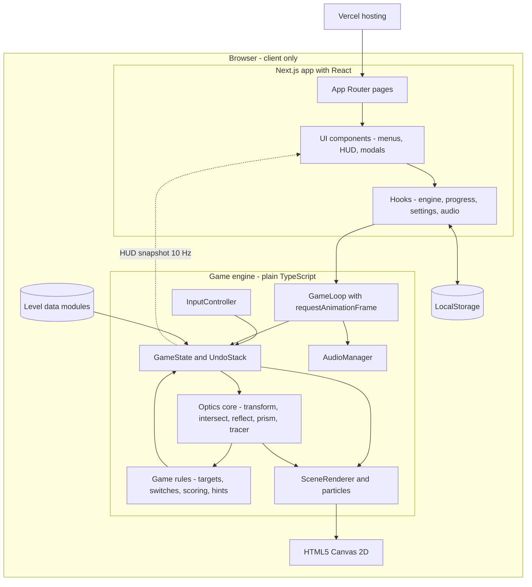
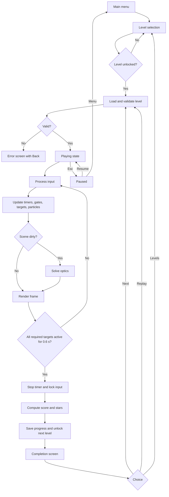
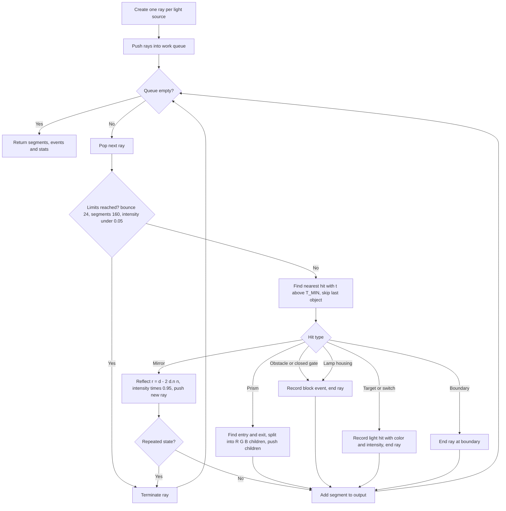
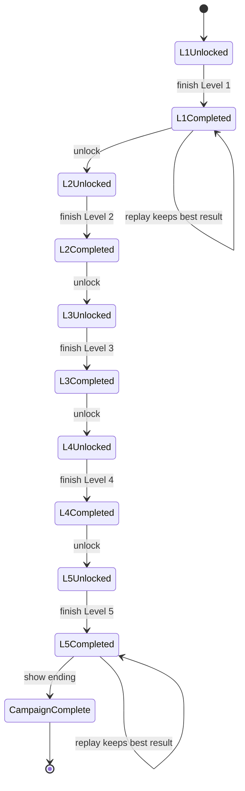

# LightPath — The Lighthouse Rescue

*Project Requirements Document (PRD) · 2D Physics-Based Optical Puzzle Game · Computer Graphics Course Project*

*Version 1.0 · 16 November 2026 · Prepared for the LightPath student development team*

## 1. Document Information and Version History

| Field | Value |
| --- | --- |
| Project name | LightPath — The Lighthouse Rescue |
| Document | Project Requirements Document (PRD) |
| Version / status | 1.0 — baseline for team review |
| Date | 16 November 2026 |
| Course | Computer Graphics (final semester, B.Sc. CSE) |
| Product type | 2D optical puzzle game, web browser, desktop-first |
| Team | About four students (names and IDs: \[to be filled by team\]) |
| Course supervisor | \[to be filled by team\] |

| Version | Date | Author | Change |
| --- | --- | --- | --- |
| 0.1 | — | Team | Project brief and outline |
| 1.0 | 16 Nov 2026 | Product and architecture review | Complete PRD baseline |
| 1.1 | Planned | Team | Update after Phase 2 prototype review; level coordinates tuned after playtesting |

### 1.1 Document Conventions

- **Priority keywords:** **Must Have** = required for MVP and for the academic grade; **Should Have** = strongly recommended, first to be cut if time runs short; **Could Have** = only if all Must and Should items are done.
- **Identifiers:** FR-### functional requirement, NFR-### non-functional requirement, CG-### graphics requirement, TC-### test case, R-## risk, AC-## acceptance criterion, A-## assumption.
- **World space:** all gameplay geometry lives in a logical world of **1280 × 720 world units (wu)**. Origin is the top-left corner, **x grows right, y grows down** (the Canvas 2D convention).
- **Angles:** stored in **degrees** in level data, converted to radians internally. **0° = +x (east)**; a **positive angle is clockwise on screen** (a consequence of y pointing down). A heading φ means direction vector (cos φ, sin φ). Examples: 90° = down, −90° = up, 180° = west.
- **Colors of light** are RGB intensity triples (r, g, b), each in \[0, 1\]. White = (1, 1, 1).
- **Terminology:** *beam* = everything emitted by one source; *ray* = one directed half-line being traced; *segment* = one straight piece of a traced path between two events; *event* = hit on mirror, prism, obstacle, target, switch, gate or boundary; *solve* = one full recomputation of all segments.

### 1.2 Explicit Assumptions

| ID | Assumption |
| --- | --- |
| A-01 | The team is four students, works about 11 weeks plus 1 buffer week, and has no professional game experience. |
| A-02 | The project is fully client-side; no backend is needed for the MVP. |
| A-03 | TypeScript (strict mode) is used; the team accepts the small learning cost. |
| A-04 | Rendering uses native HTML5 Canvas 2D; no game engine and no WebGL. |
| A-05 | Optics is a **simplified 2D educational model**: ideal mirrors (law of reflection) and a rule-based prism. It does not model wave optics, Snell's law, or real dispersion. |
| A-06 | Target browsers: current and previous major versions of Chrome, Edge, Firefox; Safari 16+ best effort. |
| A-07 | Reference hardware: a student laptop with integrated graphics, 8 GB RAM, 1080p display. |
| A-08 | Audio is synthesized with the Web Audio API or uses CC0 / team-made assets, so there are no licensing problems. |
| A-09 | English is the only UI language in the MVP. |
| A-10 | Level coordinates in Section 13 are **reference layouts**; the automated solution-replay test (TC-F13) must confirm solvability, and coordinates may be nudged during playtesting. |
| A-11 | The story and lighthouse are fictional and do not depict a real structure or rescue event. |
| A-12 | Personas in Section 6 are assumed archetypes, not results of user research. |

## 2. Executive Summary

LightPath is a browser-based 2D puzzle game in which the player repairs a storm-damaged lighthouse near a fictional island in the Sundarbans. The lamp's beam is broken; the player must rotate mirrors, redirect beams through a prism that separates white light into red, green and blue rays, open gates by lighting switches, and finally deliver light to targets that represent lost boats. Five hand-designed levels teach the mechanics progressively.

The product has two purposes. As a **course project**, it is a practical, demonstrable showcase of Computer Graphics: 2D transformations, vector reflection mathematics, ray–segment and ray–circle intersection, multi-bounce ray propagation, collision detection, animation with a delta-time game loop, particle systems, alpha and additive blending, gradients and glow. As a **game**, it must be pleasant, readable and polished enough that a first-time player can finish the five levels in about 20–30 minutes.

The technical approach is deliberately conservative: Next.js and React for application shell and screens, a hand-written engine on top of `CanvasRenderingContext2D` for all graphics, a deterministic pure-function optics core that is unit-testable without a browser, data-driven level files, and LocalStorage for persistence. Deployment is a static-friendly build on Vercel.

The most important design decision is the strict separation of **optics (math, no drawing)** from **rendering (drawing, no math rules)**. This keeps the hardest part testable, lets team members work in parallel, and makes the final presentation easy: the same numbers the optics core computes can be shown on screen through an *Optics Inspector* overlay.

## 3. Product Overview

### 3.1 Product Description

LightPath presents a night scene: dark water, a rocky island, mangrove silhouettes, a lighthouse. On top of this scene sits the puzzle board with light sources, mirrors, a prism, switches, gates, obstacles and targets. The player rotates components; the light path updates instantly and continuously, and the scene reacts with glow, sparks and sound.

### 3.2 Key Features

- Real-time multi-bounce beam tracing recomputed on every change.
- Mirrors rotatable by mouse, touch or keyboard with angle snapping.
- A prism that splits white light into red, green and blue rays with additive color mixing.
- Light-activated switches and gates; draggable obstacle; multiple light sources.
- Five levels, star scoring, three-tier hints, undo and reset.
- Atmospheric animated environment with particles and glow.
- **Optics Inspector** overlay showing normals, vectors and angles for teaching and for the viva.
- Progress and settings saved locally.

### 3.3 What Makes LightPath Different

| Ordinary 2D puzzle game | LightPath |
| --- | --- |
| Rules are arbitrary and hidden | Rules are real vector mathematics shown on demand (Inspector) |
| Visuals are decoration | Visuals *are* the algorithm output: beams are drawn from the same segments the solver computes |
| Fixed tile grid | Continuous geometry with arbitrary angles and exact intersections |
| Color is cosmetic | Color is state: R, G, B channels decide which targets and switches respond |
| Engine hides graphics theory | Each graphics concept maps to a named module and a demo action (Section 12.10) |

### 3.4 How the Project Demonstrates Computer Graphics

Every major course topic has a visible, interactive demonstration: transformations (rotating mirrors, scaled canvas), reflection (Inspector shows d, n, r), ray casting (nearest-hit highlighting), collision detection (beam stops at obstacles), animation (water, sweep beam), particles (sparks, activation burst), compositing (alpha and additive blending), and the game loop (frame-time overlay). The full mapping is in Section 12.10.

## 4. Problem Statement

**Academic problem.** Computer Graphics theory (matrices, vectors, intersection tests, compositing) is easy to memorize and hard to *see working together*. Students need a single integrated artifact where each concept has a clear, testable role and can be demonstrated live.

**Product problem.** Many educational optics tools are either physically heavy (full simulations) or visually plain. Casual puzzle games, on the other hand, rarely expose the mathematics behind their mechanics.

**Team constraint.** The team has strong web skills but no game-development background, a fixed semester deadline, and no budget.

**Resulting requirement.** Build a small, polished, mathematically honest 2D optical puzzle in the browser using only technologies the team already knows, with scope tightly controlled so that all Must Have items are finished and thoroughly tested.

## 5. Goals and Objectives

### 5.1 Objectives by Category

| ID | Category | Objective |
| --- | --- | --- |
| AO-1 | Academic | Implement and explain 2D transformations, reflection mathematics, ray–segment and ray–circle intersection, multi-bounce tracing, particle systems, compositing and a delta-time loop. |
| AO-2 | Academic | Provide a live demonstration path for every concept (Section 27). |
| AO-3 | Academic | Produce honest documentation: only experiments actually run are reported (Section 28). |
| EO-1 | Educational | Let a player discover the law of reflection (angle in = angle out) by experimentation. |
| EO-2 | Educational | Introduce additive color mixing (R + G + B = white) and the idea of splitting light, labelled as a simplified model. |
| GO-1 | Gameplay | Five levels with a gentle learning curve; each new mechanic is introduced in isolation first. |
| GO-2 | Gameplay | No failure state; the challenge is spatial reasoning, not reflexes. |
| GO-3 | Entertainment | Visual and audio feedback that makes each solved puzzle feel rewarding. |
| TO-1 | Technical | Deterministic, unit-tested optics core with tolerance-safe geometry. |
| TO-2 | Technical | Smooth rendering on integrated graphics (Section 11 targets). |
| TO-3 | Technical | Data-driven levels so adding a level needs no engine change. |

**Academic vs. entertainment objectives:** AO-\* objectives decide whether the project passes; GO-3 and polish items decide whether it impresses. If time conflicts, AO-\*, TO-1 and GO-1 always win over visual extras.

### 5.2 Measurable Success Criteria

| ID | Criterion | Measure |
| --- | --- | --- |
| SC-01 | All five levels solvable | Solution-replay automated test passes 5/5 |
| SC-02 | Reflection correctness | Reflection unit tests pass with tolerance 1e-6 on at least 20 angle pairs |
| SC-03 | Smoothness | Median frame time ≤ 16.7 ms and 95th percentile ≤ 25 ms in the worst level on the reference laptop (High quality) |
| SC-04 | Usability (only if actually tested) | At least 5 outside testers; at least 4 of 5 finish Level 1 without help; report real numbers only |
| SC-05 | Stability | 30 minutes continuous play with no uncaught exception and no memory growth beyond 50 MB |
| SC-06 | Demonstrability | Every row of the Concept Mapping Table can be shown in under 30 seconds during the demo |
| SC-07 | Delivery | Production build deployed on Vercel and also runnable offline as a static export |

## 6. Target Audience

**Primary audiences:** university students (especially CSE peers and the course evaluators), casual puzzle players, people curious about optics, and learners who enjoy educational games.

### Persona 1 — Rafi, 22, CSE student (assumed archetype)

- **Goals:** understand how reflection and ray tracing work; check the team's mathematics; maybe borrow ideas for his own project.
- **Behavior:** opens the game on a laptop in Chrome, turns on the Optics Inspector within the first minute, rotates a mirror slowly to compare numbers.
- **Expected experience:** finishes Level 1 in about 2 minutes, enjoys seeing vectors d, n, r update live, tries to break the engine with extreme angles. Needs: precise rotation, visible numbers, stable behavior.

### Persona 2 — Nusrat, 19, casual puzzle player (assumed archetype)

- **Goals:** relax for 10–15 minutes with something pretty; no interest in the math.
- **Behavior:** plays on a laptop or tablet, uses hints when stuck, cares about stars and atmosphere.
- **Expected experience:** clear tutorial text, forgiving snapping, never lost, satisfying effects when a boat is rescued. Needs: readable UI, no jargon, hints that do not feel like punishment.

### Persona 3 — Dr. Karim, course evaluator (stakeholder archetype)

- **Goals:** verify that Computer Graphics concepts are genuinely implemented, not faked by a library; judge originality and documentation quality.
- **Expected experience:** during a five-minute demo he wants to *see* a concept, hear the formula, and see it in code or in the Inspector. Needs: a crisp demo script and a toggleable presentation overlay.

## 7. Product Scope

| Scope level | Content |
| --- | --- |
| **MVP (Must)** | Five levels; mirrors, one prism type, targets (color-aware), obstacles, switch + gate, movable obstacle, two light sources in Level 4; mouse + keyboard input; undo, reset, pause, hints; stars; LocalStorage; animated environment; particles; glow; Optics Inspector; Vercel deployment; automated optics tests |
| **Version 1.1 (Should / Could)** | Touch polish, SFX variety and ambient loop, quality auto-detect, reduced-motion polish, demo-mode unlock, colored filters, rotatable prism, level-complete celebration cinematic |
| **Future** | More levels, level editor, leaderboard, accounts, curved mirrors, true refraction (Snell), multiplayer (Section 30) |

**Out of scope for the MVP:** backend, accounts, online features, WebGL, physics engines, procedural levels, moving autonomous obstacles, multiple languages, native apps.

**Scope-control rules.** (1) A feature not in the MVP row needs a written trade-off (what is dropped to make room) approved by all members. (2) Feature freeze at the end of Phase 6; Phases 7–8 only fix bugs, tune, and document. (3) Always have a playable build on the main branch.

## 8. Game Concept and Story

### 8.1 Story

A cyclone has swept across the Bay of Bengal and torn through the tidal channels of a Sundarbans island. The old lighthouse on the island's shore survived, but its lamp assembly was shattered: lenses scattered, mirrors knocked out of place, a gate jammed shut. Small wooden fishing boats are drifting in the dark among the mangrove channels, unable to see the coast.

You are the new lighthouse keeper's apprentice. Armed with a repair kit of mirrors and a salvaged prism, you must rebuild the light path piece by piece and bring each boat home.

### 8.2 Narrative Beats

| Level | Story beat |
| --- | --- |
| 1 First Light | The lamp still works. Point it at the first boat with two mirrors. |
| 2 The Broken Path | A collapsed wall blocks the straight route; find a way around. |
| 3 Color of Hope | The salvaged prism splits the beam; each boat needs a different color of light. |
| 4 The Dark Passage | A jammed gate in the dark corridor; a second lamp and a light-sensitive switch can open it. |
| 5 Lighthouse Rescue | Everything at once; when the last boat is lit, the great lamp ignites and sweeps the sea. |

### 8.3 Visual Direction

A still night with a deep-navy sky, faint stars, a low moon haze, black mangrove silhouettes, dark water with slow wave bands and cyan glints, a stone lighthouse whose lamp casts a slowly rotating decorative sweep. Beams are bright cyan-white with soft glow; prism outputs are red, green and blue. The mood is calm, mysterious and hopeful — not horror, not cartoonish.

## 9. Gameplay Mechanics

### 9.1 Core Loop

1. Observe the current beam path and the unlit targets.
2. Rotate mirrors (and drag the movable obstacle where allowed).
3. Watch the beam update instantly; use the Inspector or hints if needed.
4. When every required target is lit and stable, the level completes; score and stars are shown.

### 9.2 Component Specification

| Component | Role | Key properties | Player interaction | Optical behavior |
| --- | --- | --- | --- | --- |
| **Light source (lamp)** | Emits a beam | position, heading, color (default white), intensity 1.0, `rotatable` flag | Rotatable only if flagged (Level 4's second lamp) | Housing is a small circle that absorbs rays returning to it |
| **Mirror** | Redirects beam | center, length 96 wu, angle θ, `rotatable`, double-sided | Rotate (drag handle, wheel, keys) in angle steps | Ideal reflection, reflectance 0.95 per bounce |
| **Prism** | Splits mixed light | center, equilateral triangle circumradius 56 wu, fixed orientation, spread Δ (default 12°) | None in MVP (fixed) | Rule-based split into R, G, B rays (Section 12.9) |
| **Target (boat lantern)** | Receives light | center, radius 28 wu, required color: any / red / green / blue, `required` flag | None | Absorbs ray; charges while lit by a matching beam |
| **Obstacle** | Blocks light | convex polygon (rocks, walls), static | None | Absorbs ray (beam ends with sparks) |
| **Movable obstacle** | Blocks light, repositionable | polygon + slide axis and range, 20 wu grid snap | Drag along its axis | Same as obstacle at its current position |
| **Switch** | Triggers gate | circle radius 24 wu, required color, linked gate id | None | Absorbs ray; active while lit (momentary) |
| **Gate (locked door)** | Conditional obstacle | segment/rect, linked switch id | None | Blocks while closed; ignored while open; animated slide over 0.5 s |
| **Boundary** | Playfield limit | rectangle (40,40)–(1240,680) | None | Ray ends when it leaves; spark at the edge |

### 9.3 Component Evaluation

| Candidate feature | Decision | Reason |
| --- | --- | --- |
| Switches | **Must** (Level 4, 5) | Simple state logic, teaches dependencies |
| Rotatable reflectors | **Must** | Core verb of the game |
| Multiple light sources | **Must** in engine (array), used in Level 4 | Loop over sources costs almost nothing; makes Level 4 richer |
| Locked doors | **Must** as the gate paired with a switch | Same code path as an obstacle with an enabled flag |
| Colored filters | **Could** (v1.1) | Extra rule set; prism already provides color gameplay |
| Moving obstacles (autonomous) | **Not in MVP** | Time-dependence breaks deterministic puzzle solving and testing |
| Player-movable obstacle | **Must** (Level 5, one instance) | Adds a second verb without complexity |
| Rotatable prism | **Could** (v1.1) | Needs face-dependent deviation model |

### 9.4 Interaction Rules

- **Move definition:** one *move* is one committed player action: a completed rotation drag (pointer up with a changed angle), a keyboard or wheel step, or a completed obstacle drag. Undo does not refund moves.
- **Locked components** (`rotatable: false`) show a small lock icon and ignore rotation attempts with a soft 'thud' feedback.
- **No fail state.** The player can always undo, reset, or ask for a hint.
- **Color rules:** a beam keeps its color through mirrors; mixed light (two or more channels at or above 0.2) splits at a prism; single-channel light passes through a prism straight without splitting.
- **Completion rule:** all targets marked `required` are *active* simultaneously (Section 10, FR-035/036) for 0.6 s.

## 10. Functional Requirements

Each requirement has an ID, name, description, priority, expected behavior and acceptance criteria (AC). ACs are written so they can be verified by an automated test or a short manual check; the matching test cases are in Section 22. Priorities: **M** = Must Have, **S** = Should Have, **C** = Could Have.

### 10.1 Main Menu

| ID | Name | Pri | Description | Expected behavior | Acceptance criteria |
| --- | --- | --- | --- | --- | --- |
| FR-001 | Main menu screen | M | Landing screen with title, animated night scene and buttons | Buttons: Play, Level Selection, How to Play, Settings, About; scene animates behind | Screen renders in under 2 s; all buttons reachable by mouse and keyboard |
| FR-002 | Play / Continue | M | Starts or resumes the campaign | Label is Play if no progress, else Continue; opens the first unfinished unlocked level | With no save it opens Level 1; after Level 2 is completed it opens Level 3 |
| FR-003 | Level Selection entry | M | Opens the level grid | Navigates to /levels | Click opens grid within 300 ms |
| FR-004 | How to Play | M | Instruction screen | Shows controls, component legend (mirror, prism, target, switch, gate), color rules, scoring summary | All six component types are illustrated; Back returns to menu |
| FR-005 | Settings entry | M | Opens settings screen | Navigates to /settings | Changes apply immediately and persist (FR-054) |
| FR-006 | About | S | Project information | Shows project name, course, team, educational note on the simplified optics model | Text states that prism behavior is a simplified model |
| FR-007 | Credits | S | Credits section on About | Lists team roles, tools, asset and font licenses | Every third-party asset used is listed with its license |
| FR-008 | Menu keyboard navigation | S | Full keyboard operation of menus | Tab / Shift+Tab / Enter / Esc work; visible focus ring | Whole menu usable without a mouse |

### 10.2 Game Level System

| ID | Name | Pri | Description | Expected behavior | Acceptance criteria |
| --- | --- | --- | --- | --- | --- |
| FR-009 | Level selection grid | M | Cards for the five levels | Each card shows number, name, lock state, stars (0–3), best time | Card data matches saved progress; locked cards are visibly dimmed |
| FR-010 | Level locking | M | Unfinished prerequisites lock a level | Level n+1 locked until level n is completed; locked click gives a short shake and tooltip | Direct URL to a locked level redirects to the grid (unless demo-unlock is on) |
| FR-011 | Unlock and progression | M | Completing a level unlocks the next | Unlock is saved immediately on completion | After completing Level 1, Level 2 is playable and stays unlocked after reload |
| FR-012 | Level loading and validation | M | Load level data and check it | Validates schema (ids unique, numbers finite, links resolve); on failure shows an error screen with the reason and a Back button | Invalid level (TC-E08) never crashes the app; valid level is playable within 1 s |
| FR-013 | Level completion | M | Detect and finalize success | Triggers per FR-036; stops timer, locks input, computes score, saves, shows completion screen | Completion triggers exactly once per attempt |
| FR-014 | Level replay | M | Replay any completed level | Replay available from the completion screen and the grid; a lower score never overwrites a best | Best score/time/stars only improve |
| FR-015 | Level reset | M | Restart the current level | Restores initial angles and positions, clears undo stack, moves = 0, timer restarts; hints used in this attempt are kept | After reset the state equals the level's initial state (deep-equal test) |
| FR-016 | Next level and ending | S | Continue after success | Next Level button; after Level 5 an ending message and a return-to-menu button | Level 5 completion shows ending, not a missing Next |
| FR-017 | Pause and resume | M | Pause menu | Esc or Pause button; timer stops; options Resume, Restart, How to Play, Settings, Level Selection, Main Menu | Timer does not advance while paused; resume restores exact state |

### 10.3 Gameplay Controls

| ID | Name | Pri | Description | Expected behavior | Acceptance criteria |
| --- | --- | --- | --- | --- | --- |
| FR-018 | Hover and selection | M | Show which component is interactive | Hover outlines the component; click selects it and shows its rotation ring/handle; click on empty space deselects | Hit area is at least 44 wu for small parts; only one component selected |
| FR-019 | Mirror rotation by dragging | M | Rotate with a handle | Dragging the ring or handle sets the angle to the pointer direction from the mirror center | Rotation follows the pointer without jumps; angle wrap at 0/180 handled |
| FR-020 | Angle snapping | M | Snap to steps | Default step 15° (setting: 5° or 15°); levels may override | Final angle is always an exact multiple of the step |
| FR-021 | Wheel and keyboard rotation | S | Alternative rotation | Wheel or Left/Right (or Q/E) rotates the selected component by one step; Shift = fine step 5° | Each press changes the angle by exactly one step |
| FR-022 | Movable obstacle dragging | M | Drag along a slide axis | Pointer drag moves the obstacle within its allowed range, snapped to a 20 wu grid, never leaving the range | Obstacle never leaves its range; beam updates during the drag |
| FR-023 | Lamp rotation | M | Rotatable light sources | A source with `rotatable: true` shows a handle and rotates like a mirror | Level 4 second lamp can be aimed; fixed lamps show no handle |
| FR-024 | Undo | M | Revert last action | Stack of up to 50 actions (rotate, move); Ctrl+Z or Undo button; moves counter is not refunded | Undo restores previous angle/position exactly; button disabled when stack is empty |
| FR-025 | Keyboard shortcuts | S | Shortcut map | Tab cycle components, Arrows rotate, Z undo, R reset, H hint, D inspector, Esc pause | Shortcuts listed on How to Play and in the pause menu |
| FR-026 | Touch support | S | Pointer Events input | Same interactions with touch; `touch-action: none` on the canvas; page does not scroll while dragging | Works on a tablet or touch laptop in Chrome; no accidental page scroll |
| FR-027 | Locked component feedback | M | Show non-interactive parts | Fixed mirrors show a lock icon; rotation attempts give a soft thud and a tooltip | No input changes a locked component's state |

### 10.4 Optical Simulation

| ID | Name | Pri | Description | Expected behavior | Acceptance criteria |
| --- | --- | --- | --- | --- | --- |
| FR-028 | Ray generation | M | Source emits initial ray | Origin at source center + heading × housing radius, direction (cos φ, sin φ), color and intensity from config | First segment starts at the lamp front and points along the heading (unit test) |
| FR-029 | Multiple light sources | M | Trace every source | Engine loops over all sources; beams are independent, rendered additively | Two sources produce two beams; removing one does not affect the other |
| FR-030 | Nearest-hit intersection | M | Find the first object hit | For each ray test all active primitives, keep the smallest t > t\_min | Of two objects on a ray, the nearer one is reported (TC-G03) |
| FR-031 | Mirror reflection | M | Reflect by r = d − 2(d·n)n | Uses the mirror's current angle; double-sided; reflectance 0.95; new ray starts at hit point plus offset | Reflected heading equals 2θ − φ within 1e-6 for 20 angle pairs |
| FR-032 | Multi-bounce propagation | M | Continue after each reflection | Iterative loop until a termination condition (FR-038, FR-039) | A three-mirror path is traced fully in one solve |
| FR-033 | Obstacle blocking | M | Opaque objects end the ray | Ray ends at the hit point; spark particles emitted; closed gates behave the same | No segment passes through an obstacle polygon (TC-G05) |
| FR-034 | Prism color splitting | M | Rule-based split (Section 12.9) | Mixed beam is replaced by up to three single-channel rays with deviation −Δ, 0, +Δ from the exit point; single-channel beams pass straight | White beam on a prism yields exactly R, G, B rays with headings φ−Δ, φ, φ+Δ |
| FR-035 | Target activation | M | Charge and activate targets | Target charges while a ray of matching color and intensity ≥ 0.30 touches it; active when charge reaches 0.35 s; decays at 1.5× speed when unlit | Wrong-color beam never activates a colored target; matching beam activates in 0.35 s ± one frame |
| FR-036 | Multi-target handling and completion | M | Check all required targets | Level completes when all `required` targets are active together for 0.6 s | Level with 2 targets does not complete with 1 lit; completes when both lit |
| FR-037 | Switch and gate | M | Light-operated door | Switch is active while lit by a matching beam (momentary); linked gate opens/closes with a 0.5 s slide; closed gate blocks like an obstacle | Rotating the mirror away closes the gate again; ray tracing uses current open fraction ≥ 0.5 as open |
| FR-038 | Boundary termination | M | Rays leave the playfield | Ray is clipped at the boundary rectangle; small flare at the edge | No segment extends outside the playfield |
| FR-039 | Loop prevention and caps | M | Guarantee termination | Limits: 24 bounces per path, 160 segments per solve, min intensity 0.05, repeat-state detection (Section 20.3) | Two facing mirrors never hang the page; solve returns in under 5 ms (TC-X07) |
| FR-040 | Event-driven re-solve | M | Solve only when needed | Dirty flag set by rotation, move, gate/switch change or level load; solve runs once per frame at most | No solve runs on idle frames (counter check) |
| FR-041 | Optics Inspector | M | Educational debug overlay | Toggle with D: draws normals, incidence/reflection angles, hit points, bounce numbers, and a panel with d, n, r values and FPS/segment counts | With Inspector on, values shown match the solver output for the selected hit |

### 10.5 Scoring System

| ID | Name | Pri | Description | Expected behavior | Acceptance criteria |
| --- | --- | --- | --- | --- | --- |
| FR-042 | Timer and move counter | M | Track effort | Timer starts at first player input, stops on pause/completion; moves per Section 9.4 | Timer pauses with the pause menu and when the tab is hidden |
| FR-043 | Score formula | M | Fair numeric score | See Section 10.8 | Same inputs always give the same score (unit test) |
| FR-044 | Star rating | M | 1–3 stars | ≥ 800 = 3 stars, ≥ 500 = 2 stars, otherwise 1 star | Thresholds verified at boundary values 499/500/799/800 |
| FR-045 | Hint system | M | Three tiers per level | Hint 1: text nudge; Hint 2: pulsing highlight on the next component to adjust; Hint 3: ghost of its solution angle; each costs 100 points; 3 hints per level | HUD shows remaining hints; hints use authored `solution` data and stop at 0 |
| FR-046 | Best-result tracking | M | Keep best values | Best score, best stars, best time and best moves are stored independently | A worse replay changes none of the bests |

### 10.6 Game Feedback

| ID | Name | Pri | Description | Expected behavior | Acceptance criteria |
| --- | --- | --- | --- | --- | --- |
| FR-047 | Level complete screen | M | Result overlay | Shows stars (animated), score, time, moves, hints used, best values, buttons Next, Replay, Level Selection | Values match the scoring calculation; Next is hidden after Level 5 |
| FR-048 | Incomplete-state feedback | M | Show how close the player is | HUD 'Targets lit n/m'; unlit targets show a dim ring; blocked beams show sparks at the block; after 60 s without progress a gentle 'Need a hint?' prompt appears | No failure message ever blocks play; prompt can be dismissed |
| FR-049 | Visual feedback | M | Make state visible | Hover glow, selection ring, snap tick marks, target charge ring, activation burst, gate slide, lock icon | Each listed effect is visible in a manual checklist run |
| FR-050 | Sound effects | S | Audio cues | Rotate tick (pitch by angle step), target charge hum, activation chime, gate mechanism, UI click, level-complete jingle, low ocean ambience | Each cue plays once per event; no overlap spam (limit 8 voices) |
| FR-051 | Audio unlock and volume | S | Obey autoplay rules | Audio starts after the first user gesture; master, SFX and ambient sliders plus mute | Mute silences all audio instantly; setting persists |
| FR-052 | Tutorial messages | M | Contextual teaching | Short non-blocking messages in Levels 1–4 introduced on first need (rotate, reflect, prism, color targets, switch/gate, movable obstacle); never shown again once seen | Each message appears at most once per save; skippable with a click |

### 10.7 Progress Saving and Scene Requirements

| ID | Name | Pri | Description | Expected behavior | Acceptance criteria |
| --- | --- | --- | --- | --- | --- |
| FR-053 | Save progress | M | Persist completion data | Completed levels, best score/stars/time/moves, tutorial flags saved to LocalStorage on completion | Data survives a reload and a browser restart |
| FR-054 | Save settings | M | Persist user settings | Volumes, mute, quality, rotation step, reduced motion, demo-unlock, colorblind aid | Settings restored on next visit |
| FR-055 | Storage resilience | M | Survive broken storage | Wrap all access in try/catch; invalid JSON or disabled storage falls back to defaults and in-memory state with a small notice | App runs normally with storage blocked (TC-E10) |
| FR-056 | Schema versioning | S | Safe future changes | Saved objects carry `schemaVersion`; unknown or older versions are migrated or reset safely | Loading a v0 or malformed save does not crash |
| FR-057 | Reset progress | S | Clear save | Settings button with a confirmation dialog | Cancel changes nothing; confirm clears progress but keeps settings |
| FR-058 | Animated environment | M | Living scene | Wave bands, twinkling stars, rotating decorative lighthouse sweep, drifting mist | Visible on menu and in levels; paused only when the game is paused |
| FR-059 | Particle effects | M | Pooled particle system | Ambient motes, hit sparks, water foam, activation burst | Never exceeds the quality cap; no allocation per frame (pool) |
| FR-060 | Beam glow rendering | M | Layered glowing beams | Three-pass strokes with additive blending; endpoint radial glow | Overlapping R, G, B beams appear white where they combine |
| FR-061 | Responsive canvas | M | Fit any window | 16:9 logical world scaled uniformly with letterboxing; devicePixelRatio aware; pointer mapping inverts the transform | Hit-testing is accurate at 50%, 100% and 200% browser zoom (TC-G12) |
| FR-062 | Quality presets | S | Performance control | Low / Medium / High / Auto change particle caps, glow passes and water layers | Switching takes effect without reload |
| FR-063 | Reduced motion | S | Accessibility | Honors `prefers-reduced-motion` and a manual toggle: no screen shake, slower and fewer particles, no sweep animation | Toggle visibly reduces motion; game remains fully playable |
| FR-064 | Presentation toggles | S | Demo helpers | Keys: D inspector, G glow on/off, P particles on/off, N normals only, U demo-unlock | Each toggle works live without restarting the level |

### 10.8 Scoring Formula (referenced by FR-043)

```
timePenalty  = min(300, 2  × max(0, seconds − parTime))
movePenalty  = min(300, 15 × max(0, moves   − parMoves))
hintPenalty  = 100 × hintsUsed
score        = max(100, 1000 − timePenalty − movePenalty − hintPenalty)
stars        = 3 if score ≥ 800; 2 if score ≥ 500; else 1
```

- A completed level always yields at least **1 star** and at least **100 points**, so no player is punished into zero.
- `parTime` and `parMoves` are authored per level (Section 13) with generous slack; the team should adjust them after playtesting.
- Example: Level 2, par 90 s and 5 moves; player finishes in 130 s with 9 moves and 1 hint: timePenalty = 80, movePenalty = 60, hintPenalty = 100, score = 760, 2 stars.
- Timer ignores time spent paused or with the tab hidden.

## 11. Non-Functional Requirements

Targets are *realistic goals for a student laptop*, not guarantees. Where a number depends on hardware, the **reference laptop** (A-07) is used and the real hardware model must be recorded in the final report.

| ID | Category | Requirement | Target / measure |
| --- | --- | --- | --- |
| NFR-001 | Performance | Smooth rendering at the 1280 × 720 logical resolution, High quality | Median frame time ≤ 16.7 ms (60 FPS); 95th percentile ≤ 25 ms |
| NFR-002 | Performance | Low quality preset on weak hardware | ≥ 30 FPS on an integrated-graphics laptop of roughly 2018 class |
| NFR-003 | Performance | Optics solve time | Typical ≤ 2 ms; worst case (160 segments × ≤ 40 primitives) ≤ 5 ms |
| NFR-004 | Performance | Draw work per frame | ≤ about 600 canvas draw operations; static background drawn from a cached offscreen canvas |
| NFR-005 | Performance | Memory and GC | No allocations in per-frame hot paths (pooled particles, reused vectors); heap growth ≤ 50 MB over a 30-minute session |
| NFR-006 | Loading | Fast first load | First contentful paint ≤ 2.5 s on broadband; /play first-load JS ≤ 300 KB gzip; all assets ≤ 2 MB; level load ≤ 1 s |
| NFR-007 | Responsiveness | Window sizes | Fully playable 1024–2560 px wide; tablets landscape ≥ 768 px; portrait phones show a 'rotate your device' notice (MVP) |
| NFR-008 | Responsiveness | Input latency | Beam path visibly updates within the next frame (≤ 33 ms) after a pointer move |
| NFR-009 | Compatibility | Browsers | Latest and previous major versions of Chrome, Edge, Firefox; Safari 16+ best effort; no use of experimental canvas APIs (avoid `ctx.filter`) |
| NFR-010 | Maintainability | Code quality | TypeScript strict; ESLint + Prettier in CI; no untyped `any` without a comment; each algorithm file starts with a short comment explaining the math |
| NFR-011 | Maintainability | Separation | The optics and geometry modules import nothing from React, the DOM or the renderer |
| NFR-012 | Maintainability | Test coverage | ≥ 90% line coverage on geometry, optics, scoring and level validation; every bug fix adds a regression test |
| NFR-013 | Code organization | Structure | Folder structure of Section 18; levels are data files only; one responsibility per module; pull requests reviewed by at least one other member |
| NFR-014 | Usability | First-time success | A new player completes Level 1 in ≤ 3 minutes without outside help (verify only with real testers); every main action is ≤ 2 clicks from the menu |
| NFR-015 | Accessibility | Input | Every game action is keyboard-operable; focus ring always visible |
| NFR-016 | Accessibility | Perception | Text contrast ≥ 4.5:1; UI text ≥ 16 px (HUD ≥ 14 px); color is never the only cue (targets also carry shapes: red = triangle, green = circle, blue = square); no flashing faster than 3 per second |
| NFR-017 | Accessibility | Motion and assistive tech | Honors `prefers-reduced-motion`; canvas has an `aria-label`; an `aria-live` region announces events such as 'Target 1 of 3 lit' |
| NFR-018 | Reliability | Stability | No uncaught exception in a 30-minute soak test; React error boundary around the game with a recovery button |
| NFR-019 | Reliability | Determinism | The solver is a pure function: identical level state gives identical segments (verified by repeated-run test) |
| NFR-020 | Reliability | Numeric safety | All geometry tolerances live in one constants module (Section 20.3); no magic epsilons elsewhere |
| NFR-021 | Security | Client hardening | No secrets in the repo; no `dangerouslySetInnerHTML`; Content-Security-Policy header configured; LocalStorage JSON is validated before use |
| NFR-022 | Security | Dependencies and transport | `npm audit` shows no high or critical issues at release; HTTPS via Vercel; no third-party trackers |
| NFR-023 | Privacy | Data | No personal data collected; all saves stay in the browser |
| NFR-024 | Portability | Offline fallback | `next build` output also exported as a static site that runs without a server |
| NFR-025 | Documentation | Developer docs | README with setup, scripts, architecture summary and level-authoring guide |

## 12. Computer Graphics Requirements and Mathematical Foundations

This section is the academic core. Each subsection gives: **Concept**, **Foundation**, **Application**, **Implementation approach**, **Expected visual result**, **Demo method**. Requirement IDs CG-### tie back to the functional requirements. Section 12.10 holds the Concept Mapping Table.

### 12.1 Two-Dimensional Geometric Transformations (CG-001)

- **Concept:** translation, rotation, scaling and coordinate-system changes using 3×3 homogeneous matrices.
- **Foundation:**

```
Translation T(tx,ty) = [1 0 tx; 0 1 ty; 0 0 1]
Rotation    R(θ)     = [cosθ −sinθ 0; sinθ cosθ 0; 0 0 1]
Scaling     S(sx,sy) = [sx 0 0; 0 sy 0; 0 0 1]
Rotation about pivot c:  p' = T(c) · R(θ) · T(−c) · p
```

Because screen y points down, a positive θ rotates **clockwise** on screen. All level data and code use this one convention.

- **Application:**
  - *Local → world:* a mirror is modelled in local space as the segment from (−L/2, 0) to (+L/2, 0). Its world endpoints are A = c + R(θ)(−L/2, 0) and B = c + R(θ)(+L/2, 0). The same function supplies both the renderer and the optics, so **what is drawn is exactly what reflects light**.
  - *Translation:* placing components, dragging the movable obstacle (p' = p + Δ), moving the gate.
  - *Scaling:* the uniform view scale s = min(W/1280, H/720); target pulse (scale 1.00 ↔ 1.08); glow halo radius.
  - *Coordinate systems:* world (1280×720 wu), canvas CSS pixels, device pixels. View matrix: x\_css = s·x\_world + ox, y\_css = s·y\_world + oy with ox = (W − 1280 s)/2, oy = (H − 720 s)/2. The canvas is set with `setTransform(dpr·s, 0, 0, dpr·s, dpr·ox, dpr·oy)`.
  - *Inverse mapping for the pointer:* x\_world = (clientX − rect.left − ox)/s, and likewise for y.
- **Implementation approach:** a small `Mat3`/`Vec2` utility (no library), `save()/restore()` around each object's local drawing, a single `getWorldEndpoints(mirror)` helper, and a `ViewTransform` class owning s, ox, oy, and both directions of the mapping.
- **Expected visual result:** mirrors rotate smoothly about their centers; the picture stays correctly proportioned and sharp on any window size and Retina screens; clicks always land on the right object.
- **Demo method:** rotate a mirror with the Inspector on to show endpoints A and B changing; resize the browser window and zoom to 200% and show that selection still works.

### 12.2 Reflection Mathematics (CG-002)

- **Concept:** specular reflection of a ray from a flat mirror (law of reflection).
- **Foundation:** the reflection equation

```
r = d − 2 (d · n) n
```

with *d* = unit incoming direction, *n* = unit surface normal, *r* = unit reflected direction. Derivation: split d into a component parallel to the mirror (d∥) and one along the normal (d⊥ = (d·n)n). Reflection keeps d∥ and flips d⊥, so r = d∥ − d⊥ = d − 2(d·n)n.

- **Assumptions and conventions:**
  - d and n are unit vectors, hence |r| = 1 (renormalize after each bounce to stop floating-point drift).
  - Ideal, flat, perfectly specular, two-dimensional mirror; no scattering, absorption beyond the fixed 0.95 reflectance, or polarization.
  - Mirror angle θ is the angle of the mirror *line*; tangent t = (cosθ, sinθ); normal n = (−sinθ, cosθ) in y-down coordinates.
  - Mirrors are **double-sided**. The equation contains n twice, so flipping n → −n gives the same r; no side detection is needed.
- **Closed-form check (used as a unit-test oracle):** for incoming heading φ and mirror angle θ, the outgoing heading is **φ' = 2θ − φ (mod 360°)**.
- **Worked example:** d = (1, 0) (east), θ = −45° (a '/' mirror). n = (−sin(−45°), cos(−45°)) = (0.7071, 0.7071). d·n = 0.7071. r = (1, 0) − 2(0.7071)(0.7071, 0.7071) = (0, −1), i.e. straight up. Check: 2(−45°) − 0° = −90° = up. ✓
- **Application when the player rotates a mirror:** the new θ marks the scene dirty; at the next solve the endpoints and n are recomputed once; every hit on that mirror in the solve uses them. The solver never stores old reflection directions.
- **Expected visual result:** the reflected beam swings by **twice** the mirror's rotation, which players discover quickly.
- **Demo method:** turn the Inspector on, rotate a mirror one 15° step and show the beam turning 30° while the panel prints d, n, d·n, r and the incidence and reflection angles being equal.

### 12.3 Ray Casting and Ray Propagation (CG-003)

- **Ray:** R(t) = P + tD, with origin P, unit direction D, parameter t > 0.
- **Ray–segment intersection** (segment A→B, E = B − A, 2D cross product a×b = aₓbᵧ − aᵧbₓ):

```
den = D × E
if |den| < EPS_PARALLEL   → parallel, no hit
t = ((A − P) × E) / den
u = ((A − P) × D) / den
hit  ⇔  t > T_MIN  and  −EPS_U ≤ u ≤ 1 + EPS_U
hit point = P + tD
```

- **Ray–line intersection** is the same without the u-range test; it is used only in the Inspector to draw extended mirror lines.
- **Nearest valid intersection:** test every active primitive, discard hits with t ≤ T\_MIN, keep the hit with the smallest t. With at most about 40 primitives, brute force is fast enough; no spatial structure is added.
- **Ray continuation:** after a mirror hit: new origin = hit point + r · OFFSET (0.01 wu), new direction r, intensity × 0.95, bounce + 1, and the mirror's id stored as `skipId` so the next cast ignores it (a flat mirror cannot be hit twice in a row).
- **Termination conditions:** (1) absorbed by obstacle, closed gate, target, switch or lamp housing; (2) leaves the playfield; (3) intensity < 0.05; (4) more than 24 bounces on one path; (5) more than 160 segments in one solve; (6) repeated-state detection (Section 20.3).

|  | Basic ray casting | LightPath multi-bounce propagation |
| --- | --- | --- |
| Question answered | What does this one ray hit first? | What is the complete light path of every beam? |
| Output | One hit record | A list of colored segments plus event records |
| State | None | Color, intensity, bounce count, skipId per ray |
| Branching | None | Prism creates up to three child rays (work queue) |
| Termination | Single result | Six rules above guarantee termination |

- **Application and visual result:** the traced segments are exactly what is drawn, so the player sees a crisp polyline of light that bends the instant a mirror turns.
- **Demo method:** Inspector shows each hit point with its bounce number; drag a mirror and show the nearest hit jumping from one object to another when one is moved in front of another.

### 12.4 Collision Detection (CG-004)

| Interaction | Technique | Notes |
| --- | --- | --- |
| Ray vs mirror | Ray–segment (12.3) | Segment endpoints from the transform helper |
| Ray vs obstacle | Ray–segment against every edge of a convex polygon, nearest wins | Polygons are stored as vertex lists; edges derived once per frame for movable ones |
| Ray vs target, switch, lamp housing | Ray–circle quadratic: b = D·(P−C), c = | P−C |
| Ray vs prism | Ray–segment against the three edges; collect all hits sorted by t; first = entry, second = exit | A single (grazing-vertex) hit is treated as a miss |
| Ray vs gate | Ray–segment when closed (open fraction < 0.5); skipped when open | Open fraction animates with dt |
| Ray vs boundary | Four ray–segment tests on the playfield rectangle | Always hits something, so a cast never returns 'nothing' |
| Pointer vs mirror / lamp | Point-to-segment distance ≤ 24 wu; handle: point-in-circle (radius 22 wu) | 44 wu minimum touch target |
| Pointer vs obstacle | Point-in-convex-polygon (all cross products same sign) | Used for dragging |

**Tolerance policy:** a single `constants` module defines EPS\_PARALLEL = 1e-9, EPS\_U = 1e-6, T\_MIN = 1e-3 wu, OFFSET = 0.01 wu, ANGLE\_EPS = 1e-6°. The small EPS\_U overlap prevents a ray from slipping through the shared corner of two polygon edges.

- **Expected visual result:** beams stop exactly on the surface of rocks, glance off mirror ends correctly, and never leak through corners.
- **Demo method:** enable Inspector, aim the beam at a polygon corner and show it still stops.

### 12.5 Animation (CG-005)

All animation is **time-based** (uses dt in seconds), never frame-count-based, so speed is identical at 30 and 144 FPS.

| Effect | Model | Parameters |
| --- | --- | --- |
| Animated laser beam | Moving dash highlight over each segment: `lineDashOffset = −speed·t` | speed 240 wu/s; dash 18/46 wu; intensity pulse ±3% |
| Moving water | 3–4 layered bands y = y₀ + A sin(kx + ωt + φ), parallax by layer | A 3–10 wu, ω 0.4–1.2 rad/s |
| Lighthouse rotation | Decorative sweep: angle ψ(t) = ψ₀ + 18°/s · t, drawn as a clipped additive gradient sector | Alpha ≤ 0.12 so it never confuses the puzzle beams |
| Twinkling stars | alpha = 0.55 + 0.45 sin(ωt + φᵢ) | 60 stars, individual phase |
| Glowing objects | Scale pulse 1 + 0.04 sin(2πft) on target rings and switches | f = 0.5 Hz |
| Gate slide | Open fraction animated with easeOutCubic over 0.5 s |  |
| Target charge | Ring fill = charge / 0.35 s; color lerp dim → bright |  |
| UI transitions | 200–300 ms fades and slides | Disabled when reduced motion is on |

- **Expected visual result:** a living night scene that never distracts from the beam.
- **Demo method:** throttle the browser (DevTools CPU slowdown) and show motion speed staying the same, proving delta-time use.

### 12.6 Particle System (CG-006)

- **Concept:** many small, short-lived sprites with simple per-particle physics.
- **Foundation (per frame, per particle):**

```
v  ← v · (1 − drag · dt)        (linear drag)
p  ← p + v · dt                 (explicit Euler integration)
life ← life − dt
alpha = easeOut(life / maxLife)
size  = size0 · (0.6 + 0.4 · life / maxLife)
```

- **Data structure:** a fixed-size **object pool** with a free list; spawning reuses a dead slot, so no allocation or garbage collection during play. Each particle holds x, y, vx, vy, life, maxLife, size, color, kind.
- **Emitters:**

| Emitter | Spawn rule | Motion | Lifetime / look |
| --- | --- | --- | --- |
| Ambient motes (fireflies, sea spray) | Random in playfield, up to cap | Slow drift ±6 wu/s plus sinusoidal wobble; wrap at edges | 6–12 s; size 1–2.5; soft cyan-white; fade in and out |
| Hit sparks | 12 per second at each beam end that hits an absorber or mirror (max 6 emitting hits) | Radial, biased along the surface normal, 40–120 wu/s, drag 2.5 | 0.3–0.6 s; additive; beam color |
| Water foam and ripples | 3 per second near rocks and boats | Expanding ellipse ring, no velocity | 1.5–2.5 s; alpha fades |
| Target activation burst | 36 particles once on activation, plus a shock ring growing radius 28 → 120 wu in 0.6 s | Radial 80–220 wu/s, drag 1.8 | 0.8–1.4 s; target color; additive |
| Gate dust | 6 particles while the gate moves | Small downward drift | 0.5 s |

- **Caps by quality:** High 400, Medium 200, Low 80 particles total; ambient motes cap 80 / 40 / 15. When the cap is reached, new low-priority particles (ambient) are dropped first.
- **Rendering:** particles drawn in one pass per blend mode (normal, then additive with `lighter`); no per-particle `save()/restore()`.
- **Expected visual result:** sparks where light hits a surface, a satisfying burst when a boat is rescued, a gently alive night.
- **Demo method:** press P to toggle particles off and on; show the pool size in the Inspector and that it never exceeds the cap even when the beam sweeps rapidly.

### 12.7 Light and Visual Effects (CG-007)

| Technique | Foundation | Use in LightPath |
| --- | --- | --- |
| Alpha blending | C = α·Cₛ + (1 − α)·Cᵢ (source-over) | Soft glow layers, UI panels, mist, fading particles |
| Additive blending | C = min(1, Cᵢ + α·Cₛ) via `globalCompositeOperation = 'lighter'` | Beams, sparks, halos; overlapping red, green and blue beams add up to white |
| Layered glow | Three strokes of one polyline: width 14 at alpha 0.08, width 7 at 0.18, core width 2.2 at 1.0 | The beam's soft halo without the cost of `shadowBlur` |
| Radial gradients | `createRadialGradient`, **pre-rendered once into small glow sprites** and drawn with `drawImage` | Target and switch halos, beam end flares, moon haze |
| Linear gradients | `createLinearGradient` | Sky, water depth, lighthouse sweep fade |
| Shadows | Cheap fake shadows only: a soft ellipse under rocks and a 4 wu offset translucent copy under mirrors; `shadowBlur` only for target halos on High quality | Gives depth without real-time shadow casting (beam shadow casting is an explicit non-goal) |
| Transparency | Intensity → alpha (alpha = 0.25 + 0.75·I) | Beams fade after each 0.95 reflectance loss |
| Color transitions | Linear interpolation lerp(a, b, e(t)) with easing | Target dim → bright, star reveal, UI hover states |
| Darkness mask (Level 4 only) | Offscreen canvas filled with translucent navy, then radial holes cut with `destination-out` at sample points along each segment (≤ 120 per frame) | 'Dark Passage' atmosphere: only the beam reveals the corridor |
| Offscreen caching | Static background drawn once per resize into an offscreen canvas, then one `drawImage` per frame | Large performance win; shows double-buffering idea |

- **Expected visual result:** luminous beams that visibly add when they overlap, soft halos, and a calm dark scene.
- **Demo method:** press G to switch glow passes off and on (before/after), then show the white spot where R, G and B beams overlap.

### 12.8 Game Loop (CG-008)

- **Driver:** `requestAnimationFrame` callback receives a high-resolution timestamp. `dt = clamp((now − last) / 1000, 0, 0.05)`. The clamp prevents huge steps after a stall; on tab return `last` is reset so dt does not spike.
- **Variable vs. fixed time step:** a variable step is acceptable because there is no physics integration; the optics solve is independent of dt and animations are simple time functions. Particle integration is stable at dt ≤ 0.05.
- **Per frame:**

```
1. processInput()   drain the event queue filled by pointer/keyboard listeners
2. update(dt)       timers, gate open fraction, target charge, switches, completion check,
                    particles, environment animation clocks (skipped while PAUSED)
3. if dirty: solveOptics()   rebuild segments + events, clear dirty flag
4. render()         draw layers in order (below), then overlays
```

- **Render order:** background cache → water → island and lighthouse → obstacles and gates → mirrors, prism, lamp, targets, switches → beams (additive) → particles → darkness mask (Level 4) → selection rings, hints, Inspector → HUD (React DOM above the canvas).
- **Game state machine:** `BOOT → MENU → LEVEL_SELECT → LOADING → PLAYING ⇄ PAUSED → COMPLETE → (LEVEL_SELECT or LOADING next)`. Input is accepted only in PLAYING; PAUSED stops update but keeps rendering a dimmed frame.
- **React integration:** the engine owns a mutable `GameState` object outside React. React owns screens, settings and progress. The HUD reads a small snapshot (time, moves, targets lit, hints) at most 10 times per second through `useSyncExternalStore`. React **never** re-renders per frame.
- **Lifecycle safety:** the game component starts the loop on mount and on unmount cancels the frame request and removes all listeners (safe under React Strict Mode double-mounting).
- **Demo method:** show the FPS and frame-time graph in the Inspector, toggle quality presets, and explain the update/solve/render split.

### 12.9 Prism Simulation — Simplified Educational Model (CG-009)

**Honesty statement:** the prism is a **rule-based dispersion illustration**. It does not use Snell's law, wavelength-dependent refractive index, or face angles. It is clearly labelled 'simplified model' in the game's About text and in the report.

**Beam color model:** each ray carries (r, g, b) in \[0, 1\] and a scalar intensity I. White light = (1, 1, 1). Pure red = (1, 0, 0), etc. Colors are rendered with additive blending, so R + G + B overlap appears white.

**Rules:**

1. A ray is *mixed* if at least two channels are ≥ 0.2. Only mixed rays split.
2. A single-channel (colored) ray that hits a prism passes straight through, unchanged except for the transmittance loss, and does not split.
3. Find entry and exit points on the prism triangle with the ray–segment test (12.4). The interior segment is drawn as a faint white line.
4. At the exit point emit one child ray per channel with value ≥ 0.05: direction D' = rot(D, δₖ), with δᴿ = −Δ, δᴳ = 0, δᴮ = +Δ, where

```
rot(D, δ) = (Dx cosδ − Dy sinδ,  Dx sinδ + Dy cosδ)
```

5. Child color = channel value on its own axis only, e.g. red child = (r, 0, 0); child intensity = I · 0.9 (prism transmittance).
6. Default Δ = 12° (level override 8–15°). Children start at the exit point + OFFSET and skip the prism id for their first cast. Children follow normal propagation (mirrors, obstacles, targets).

**Worked example:** a white beam heading φ = 0° produces red at −12° (up-right), green at 0°, blue at +12° (down-right) on screen. The fan widens by about 0.21 wu per wu of travel (tan 12° ≈ 0.2126), so after 600 wu the red and blue rays are about 128 wu above and below the green ray.

**Limitations (to state in the report):** deviation does not depend on prism rotation or face; red/blue ordering is symmetric rather than physical; re-combining colors by a second prism is not modelled; no total internal reflection.

- **Expected visual result:** a bright white beam turns into a clean red-green-blue fan.
- **Demo method:** Level 3, Inspector on: show the three child rays and their headings φ−Δ, φ, φ+Δ; change Δ in the level file and reload to show the data-driven fan.

### 12.10 Computer Graphics Concept Mapping Table

| Concept | Mathematical / theoretical foundation | Application in LightPath | Module | Expected visual result | 30-second demo |
| --- | --- | --- | --- | --- | --- |
| Translation | p' = p + Δ | Drag movable obstacle, place objects | `lib/math/vec2` | Obstacle follows pointer on its rail | Drag the rock in Level 5 |
| Rotation | R(θ); pivot form T(c)R(θ)T(−c) | Mirror and lamp rotation | `lib/math/mat3`, `engine/optics/transform` | Smooth turning about center | Rotate a mirror with Inspector endpoints |
| Scaling | S(s,s), uniform view scale | Responsive canvas, target pulse | `engine/core/ViewTransform` | Sharp picture at any window size | Resize window, zoom 200% |
| Coordinate systems | World, CSS px, device px; inverse mapping | Pointer hit-testing | `ViewTransform` | Clicks land on the right object | Click a small handle after resizing |
| Reflection | r = d − 2(d·n)n; φ' = 2θ − φ | Mirror bounces | `engine/optics/reflect` | Beam turns twice the mirror's rotation | Rotate 15°, beam moves 30° |
| Ray–segment intersection | Parametric solve with cross products | Mirrors, obstacles, gates, boundary | `engine/optics/intersect` | Beam ends exactly on surfaces | Aim at a rock corner |
| Ray–circle intersection | Quadratic equation | Targets, switches, lamp housing | `engine/optics/intersect` | Target lights on contact only | Graze a target's edge |
| Nearest-hit ray casting | Minimum t over primitives | First object on the beam path | `engine/optics/tracer` | Correct object always stops the beam | Slide the rock into the beam |
| Multi-bounce propagation | Iterative ray tracing with work queue | Full light path with branches | `engine/optics/tracer` | Polyline bending through 3+ mirrors | Level 2 solution path |
| Loop and numeric safety | Epsilons, skip-id, state hashing, caps | Facing-mirror loop safe | `lib/math/constants`, tracer | No freeze, beam fades out | Make two mirrors face each other |
| Collision / hit testing | Segment distance, point-in-polygon | Selecting and dragging | `engine/core/InputController` | Hover outline accurate | Hover each component type |
| Prism dispersion (simplified) | rot(D, δ); rule-based split | White → R, G, B | `engine/optics/prism` | RGB fan | Level 3 with Inspector headings |
| Additive blending | C = min(1, Cᵢ + αCₛ) | Beam overlap becomes white | `render/layers/BeamLayer` | White overlap spot | Toggle G; overlap R+G+B |
| Alpha blending, transparency | C = αCₛ + (1−α)Cᵢ | Glow, mist, UI panels | `render/*` | Soft translucent layers | Toggle glow passes |
| Gradients and glow sprites | Linear and radial gradient interpolation | Sky, water, halos | `render/glowSprites`, `BackgroundLayer` | Smooth halos | Zoom on a target halo |
| Animation | Time functions, easing | Water, stars, sweep, gate | `render/layers/WaterLayer`, `core` | Moving environment | CPU-throttle test (same speed) |
| Particle system | Euler integration, drag, pooling | Sparks, bursts, motes | `engine/particles/ParticlePool` | Sparks and burst | Toggle P; solve a target |
| Game loop, delta time | rAF, clamped dt | Update/solve/render | `engine/core/GameLoop` | Stable speed | Inspector frame graph |
| Offscreen caching | Double buffering idea | Static background layer | `render/layers/BackgroundLayer` | Higher FPS | Toggle cache in Inspector |
| State machine | Finite automaton | Menu/play/pause/complete | `engine/core/GameState` | Predictable screens | Pause and resume |

## 13. Level Design Specifications

**Common rules for all levels:** world 1280 × 720 wu; playfield boundary (40, 40)–(1240, 680); mirrors 96 wu long and double-sided; angle step 15°; target radius 28 wu; switch radius 24 wu; lamp housing radius 16 wu; 3 hints per level. A mirror line at θ and θ + 180° is the same mirror, so solution angles are compared **modulo 180°**. Each level lists a `solution` (component id → angle or position) used by the hint system and by the automated solution-replay test (TC-F13). Coordinates were computed from the reflection and prism formulas of Section 12 and are reference layouts (A-10): the team must confirm them with the validator and may shift positions by a few units during playtesting.

**Mirror angle cheat-sheet (y-down screen):** a '/' mirror is θ = 135° (≡ −45°): it turns east → up and up → east. A '\\' mirror is θ = 45°: it turns east → down and down → east. θ = 90° (vertical) sends a beam heading east straight back west.

### Level 1 — First Light

| Field | Specification |
| --- | --- |
| Story / objective | The lamp still works. Aim it at the first boat using two mirrors. |
| Difficulty | Very easy (tutorial) |
| Light source | S1 at (120, 560), heading 0° (east), white, fixed |
| Mirrors | M1 (500, 560): start 90°, solution 135°. M2 (500, 260): start 0°, solution 135°. Both rotatable |
| Targets | T1 at (1000, 260), color any, required |
| Obstacles | None |
| Path when solved | East along y = 560 → M1 turns it up → north along x = 500 → M2 turns it east → east along y = 260 → T1 |
| Required actions | Rotate M1 and M2 (about 45° each) |
| Special mechanics | None; introduces rotation handle, snapping, reflection, target charging |
| Completion | T1 active for 0.6 s |
| Par | 45 s, 3 moves |
| Tutorial messages | 'Drag the ring to rotate a mirror'; 'Light leaves a mirror at the same angle it arrived'; hints available from the start |
| Graphics concepts | Rotation transform, reflection, ray–segment and ray–circle intersection, glow, sparks, target burst |

### Level 2 — The Broken Path

| Field | Specification |
| --- | --- |
| Story / objective | A collapsed wall blocks the straight route. Go around it. |
| Difficulty | Easy |
| Light source | S1 at (100, 360), heading 0°, white, fixed |
| Mirrors | M1 (300, 360): start 90°, solution 135°. M2 (300, 140): **fixed** at 135° (locked icon). M3 (900, 140): start 0°, solution 45°. M4 (900, 360): start 90°, solution 45° |
| Targets | T1 at (1140, 360), color any, required |
| Obstacles | Wall W1, rectangle x 600–660, y 240–480 (blocks the direct line y = 360) |
| Path when solved | East → M1 up → M2 east along y = 140 → M3 down along x = 900 → M4 east along y = 360 → T1 |
| Required actions | Rotate M1, M3, M4 (M2 is already correct and locked) |
| Special mechanics | A fixed mirror; an obstacle that punishes the 'shoot straight' idea (beam visibly ends with sparks on the wall) |
| Completion | T1 active for 0.6 s |
| Par | 90 s, 5 moves |
| Graphics concepts | Multi-bounce propagation (4 bounces), nearest-hit selection, polygon collision, locked-object feedback |

### Level 3 — Color of Hope

| Field | Specification |
| --- | --- |
| Story / objective | The salvaged prism splits the beam. Light each boat with its own color. |
| Difficulty | Medium |
| Light source | S1 at (100, 620), heading 0°, white, fixed |
| Mirrors | M1 (220, 620): start 90°, solution 135°. M2 (220, 360): start 0°, solution 135°. M3 (700, 311): start 0°, solution 135°. M4 (700, 408): start 90°, solution 45° |
| Prism | P1 at (440, 360), fixed, Δ = 12° (white beam heading 0° produces red at −12°, green at 0°, blue at +12°) |
| Targets | T\_R (745, 100) red; T\_G (1140, 360) green; T\_B (745, 620) blue; all required |
| Obstacles | None |
| Path when solved | S1 → M1 up → M2 east → P1 splits → green continues east to T\_G; red hits M3 (turns nearly north) to T\_R; blue hits M4 (turns nearly south) to T\_B |
| Required actions | Rotate M1–M4 |
| Special mechanics | Prism, colored beams, color-specific targets (shape icons ▲ ● ■ shown beside colors) |
| Completion | All three targets active together for 0.6 s |
| Par | 120 s, 7 moves |
| Tutorial messages | 'White light is a mix of colors. The prism pulls it apart (simplified model).'; 'Each boat only answers to its own color.' |
| Graphics concepts | Prism rule-based dispersion, rotation of direction vectors, additive blending, color-aware activation |

### Level 4 — The Dark Passage

| Field | Specification |
| --- | --- |
| Story / objective | A jammed gate blocks the corridor in the dark. Power the switch with one lamp to open the way for the other. |
| Difficulty | Medium |
| Light sources | S1 (100, 620), heading 0°, fixed. S2 (100, 200), start heading −30°, solution 0°, **rotatable** |
| Mirrors | M1 (300, 620): start 90°, sol 135°. M2 (300, 480): start 0°, sol 135°. M3 (780, 480): start 0°, sol 45°. M4 (780, 620): start 90°, sol 45°. M5 (1000, 200): start 90°, sol 45° |
| Switch and gate | SW1 at (1000, 620), color any, momentary; gate G1 at x = 650, y 140–260, closed until SW1 is lit |
| Targets | T1 at (1000, 420), color any, required (SW1 is not required itself) |
| Obstacles | B1 rectangle x 420–460, y 540–700 (blocks the direct beam along y = 620) |
| Path when solved | S1 → M1 up → M2 east along y = 480 → M3 down → M4 east along y = 620 → SW1 (gate opens). S2 east along y = 200 through the open gate → M5 down along x = 1000 → T1 |
| Required actions | Aim lamp S2; rotate M1–M5 |
| Special mechanics | Two light sources, rotatable lamp, light switch and gate (momentary: breaking the S1 path closes the gate), obstacle, darkness mask (only beams reveal the scene) |
| Completion | T1 active for 0.6 s |
| Par | 150 s, 9 moves |
| Tutorial messages | 'Some doors answer to light.'; 'This lamp can be turned too.' |
| Graphics concepts | State-dependent collision geometry, multiple sources with additive blending, `destination-out` darkness mask, polygon collision |

### Level 5 — Lighthouse Rescue

| Field | Specification |
| --- | --- |
| Story / objective | Everything at once. Split the light, open the gate with blue, free the path for green, and light the red boat. |
| Difficulty | Hard (but fair; only known mechanics) |
| Light source | S1 at (100, 620), heading 0°, white, fixed |
| Mirrors | M1 (220, 620): start 90°, sol 135°. M2 (220, 360): start 0°, sol 135°. M3 (700, 311): start 0°, sol 135°. M4 (700, 408): start 90°, sol 45° |
| Prism | P1 at (440, 360), fixed, Δ = 12° |
| Switch and gate | SW1 at (745, 620), requires **blue**; gate G1 at x = 910, y 310–410, closed until SW1 is lit; it blocks the green beam |
| Targets | T\_R (745, 100) red; T\_G (1140, 360) green; both required |
| Movable obstacle | Rock R1, 60 × 40 wu, starts at (720, 540), slides along x in \[560, 1000\] on a 20 wu grid; initially blocks the blue beam; it must be moved at least two steps left (to x ≤ 680) or to x ≥ 780 |
| Path when solved | S1 → M1 → M2 → P1. Red: M3 → T\_R. Blue: M4 → (rock moved) → SW1 → gate opens. Green: straight east through the open gate → T\_G |
| Required actions | Rotate M1–M4; drag R1 |
| Special mechanics | Prism + color roles + switch/gate dependency + movable obstacle |
| Completion | T\_R and T\_G active together for 0.6 s; then the great lamp ignites (about 2 s celebration) before the result screen |
| Par | 210 s, 10 moves |
| Graphics concepts | All of the above combined, plus the finale sweep animation, particle burst and glow |

### 13.1 Difficulty Curve and Level Validation

| Level | New idea | Minimum interactions | Fixed pieces |
| --- | --- | --- | --- |
| 1 | Rotate, reflect | 2 | 0 |
| 2 | Longer path, obstacle, locked mirror | 3 | 1 mirror |
| 3 | Prism and colors | 4 | prism |
| 4 | Switch, gate, second lamp, darkness | 6 | gate, B1 |
| 5 | Combination | 5 | prism, gate |

- **Solution-replay test:** load each level, apply `solution`, run the solver, assert every required target is active (TC-F13).
- **Initial-state test:** assert that no level starts already solved.
- **Spacing check:** the validator warns if any two components overlap or if a mirror's full rotation sweep touches another solid.
- **Playtest rule:** if more than 1 of 5 testers needs more than 5 minutes on Levels 1–2, reduce difficulty (add a fixed mirror, shorten the path).

## 14. UI/UX Specifications

### 14.1 Design System

| Token | HEX | Use |
| --- | --- | --- |
| Abyss | #040813 | Page background |
| Midnight | #0A1530 | Panels, HUD background (at 80% opacity) |
| Deep Navy | #11224A | Cards, modals |
| Navy Line | #26417A | Borders, dividers |
| Cyan Beam | #22D3EE | Primary accent, primary buttons, selection |
| Ocean Teal | #14B8A6 | Secondary accent, progress |
| Beam Core | #E6FBFF | Beam core, highlights |
| Soft White | #F1F7FF | Primary text |
| Mist | #9FB3D1 | Secondary text, disabled labels |
| Light Red | #FF4D6D | Red channel, red targets |
| Light Green | #4DFF9F | Green channel, green targets |
| Light Blue | #4D9BFF | Blue channel, blue targets |
| Star Gold | #FFD166 | Stars |
| Success / Warning / Danger | #34D399 / #FBBF24 / #F87171 | Status and destructive actions |

- **Contrast:** Soft White on Midnight and dark text (Abyss) on Cyan Beam both exceed 7:1; Mist on Midnight exceeds 4.5:1 (verify with a contrast checker before release).
- **Typography direction:** headings **Space Grotesk** (600/700), body **Inter**, numbers and Inspector **JetBrains Mono**, loaded with `next/font` (self-hosted at build, no runtime font request) with `system-ui` fallbacks. Sizes: title 56 px, H2 32 px, body 16 px, HUD 14–16 px, caption 12 px.
- **Shape and spacing:** 8 px spacing scale; card radius 12 px, button radius 8 px; depth comes from subtle cyan glow rather than heavy shadows.
- **Icons:** one line-icon set (Lucide) or small inline SVGs; icons always have text labels or `aria-label`.
- **Visual feedback vocabulary:** hover = soft cyan outline; selected = rotation ring with tick marks at each snap step; locked = padlock; target charging = ring fill; target active = bright fill plus burst; hint = pulsing amber ring (Warning color) or ghost mirror at 40% opacity.

### 14.2 Screens

| # | Screen (route) | Purpose and layout | Key components and actions |
| --- | --- | --- | --- |
| 1 | Main Menu (`/`) | Full-screen animated night scene; title 'LightPath' with subtitle; vertical button stack in the left third | Play/Continue (primary), Level Selection, How to Play, Settings, About; mute toggle; version label |
| 2 | Level Selection (`/levels`) | 5 cards in a responsive grid, each with number, name, mini preview icon, stars, best time, lock | Click to start; locked cards shake and show 'Complete Level n first'; Back |
| 3 | Game Instructions (`/how-to-play`) | Four stacked panels: Goal, Controls, Component legend, Scoring and hints | Icons next to each component; shortcut table; Back |
| 4 | Gameplay (`/play/[levelId]`) | Canvas fills the viewport (16:9, letterboxed); HUD overlay in DOM | HUD below; pointer interaction on canvas |
| 5 | Pause menu (modal on 4) | Dimmed scene, centered card | Resume, Restart, How to Play, Settings, Level Selection, Main Menu |
| 6 | Settings (`/settings`) | Single column of grouped controls | Volume sliders (master, SFX, ambient), mute, quality (Auto/Low/Medium/High), rotation step (5/15), reduced motion, colorblind aid, demo-unlock, Reset progress (danger, confirm dialog) |
| 7 | Level Completion (modal on 4) | Card over a calm dimmed scene with burst effects | Animated stars, score, time, moves, hints, best values; Next, Replay, Level Selection |
| 8 | About / Credits (`/about`) | Project text, educational note about the simplified model, team roles, tools and licenses | Back |

### 14.3 Gameplay HUD

- **Top left:** level number and name. **Top center:** target indicators (shape + color + filled when active). **Top right:** time (mm:ss), moves, stars preview.
- **Bottom left:** Undo, Reset, Hint (with remaining count). **Bottom right:** Inspector toggle, Sound, Pause.
- **Bottom center:** tutorial toast (auto-dismiss after 6 s or on click).
- HUD uses real DOM elements (crisp text, accessible), semi-transparent Midnight background, never covering the playfield center. Canvas pointer events are not blocked outside HUD buttons.

### 14.4 Navigation, Loading and Transitions

- Next.js routes as in the table; browser Back works; Esc opens pause in play.
- Route changes use a 250 ms fade. A level that loads in under 400 ms shows nothing extra; slower loads show a small pulsing lamp icon with the text 'Lighting the lamp…'.
- A locked or invalid level URL redirects to `/levels` with a toast.
- Reduced-motion mode replaces fades and slides with instant changes.
- Responsive: below 1024 px width HUD buttons shrink to icon-only; in portrait on phones a full-screen 'Rotate your device' notice is shown (MVP).

## 15. Technology Stack

### 15.1 Chosen Technologies and Responsibilities

| Technology | Responsibility in LightPath | Notes |
| --- | --- | --- |
| **Next.js (App Router)** | Routing, page shells, build, Vercel deployment, `next/font` | Pages are client components for the game; no server features required |
| **React** | Menus, settings, HUD, modals, accessibility semantics | Does **not** render the game scene and does not re-render per frame |
| **TypeScript (strict)** | Types for level data, optics results, state | Catches data errors early; interfaces in Section 19 |
| **Tailwind CSS + CSS variables** | UI styling and the design tokens of Section 14.1 | Team already knows it; tokens in `styles/tokens.css` |
| **HTML5 Canvas 2D** | All scene drawing: background, water, components, beams, particles, overlays | `CanvasRenderingContext2D` only |
| **Plain TypeScript engine** | Game loop, input, state, optics, particles, audio | Hand-written; this is the academic content |
| **Web Audio API** | Synthesized sound effects and ambience | No audio files needed (A-08) |
| **LocalStorage** | Progress and settings persistence | Versioned JSON with validation |
| **Vitest** | Unit tests for geometry, optics, scoring, validator, solution replay | Runs in Node, no browser needed |
| **ESLint + Prettier + GitHub Actions** | Quality gates: lint, type-check, test, build on every pull request | Keeps four people's code consistent |
| **Vercel** | Hosting, preview deployments per pull request | Static-friendly build |
| **Node.js** | Tooling and build only (LTS version) | No runtime server code in the MVP |

### 15.2 Is a Game Engine Needed? (Decision)

| Option | Verdict | Reason |
| --- | --- | --- |
| Phaser | **Not used** | Hides the game loop, scene graph, collision and tweening that the course wants the team to *implement and explain*; adds bundle size and an API to learn |
| PixiJS / WebGL | Not used | Canvas 2D is sufficient for about 600 draw calls; WebGL adds shader complexity beyond the course scope |
| p5.js | Not used | Convenient, but obscures the underlying canvas API and fits React/Next poorly |
| Matter.js / physics engines | Not used | The puzzle is geometric optics, not rigid-body physics |
| Three.js | Not used | The game is 2D |
| **Native Canvas 2D** | **Chosen** | Direct control, minimal size, best match for the academic goals, and every concept is visible in our own code |

The word 'physics-based' in the project description refers to the **optical** model (reflection and a simplified dispersion rule), not to a physics engine.

### 15.3 Backend

None for the MVP (Section 21). Node.js route handlers are reserved for a possible future leaderboard. No database is introduced.

## 16. System Architecture

### 16.1 Architecture Principles

1. **Optics is pure:** math in, segments out; no DOM, no React, no drawing.
2. **Render only draws:** it receives the state and the optics result and never decides rules.
3. **React is the shell:** it owns screens and persisted data; the engine owns the frame loop.
4. **Data-driven levels:** adding a level means adding a data file.
5. **One source of truth per fact:** unlock status is derived from completion records; component geometry comes from one transform helper.

### 16.2 Layers and Responsibilities

| Layer | Responsibility |
| --- | --- |
| Frontend (Next.js + React) | Routes, screens, HUD, settings, accessibility, mounting the canvas |
| Game engine (`engine/core`) | Loop, state machine, input queue, undo stack, view transform, orchestration |
| Optics core (`engine/optics`) | Transform helper, intersections, reflection, prism rule, ray tracer |
| Game rules (`game`) | Target and switch logic, completion, scoring, hints, level validation |
| Rendering (`engine/render`, `engine/particles`) | Layered canvas drawing, glow sprites, particles, overlays |
| Input (`InputController`) | Pointer Events and keyboard to a command queue |
| State | Mutable `GameState` for the scene; React state for UI; HUD snapshot at 10 Hz |
| Level configuration (`levels`) | Typed, validated data modules |
| Persistence (`lib/storage`) | Versioned LocalStorage access with fallbacks |

- **Input architecture:** DOM listeners translate pointer and key events into small command objects (`select`, `rotateTo`, `rotateStep`, `dragObstacle`, `undo`, `reset`, `hint`, `pause`) pushed into a queue. The engine drains it at the start of each frame. This keeps input timing deterministic and testable.
- **Rendering architecture:** `SceneRenderer` calls an ordered list of layer objects (`BackgroundLayer`, `WaterLayer`, `ComponentsLayer`, `BeamLayer`, `ParticleLayer`, `DarknessLayer`, `OverlayLayer`, `InspectorLayer`), each with `draw(ctx, state, optics, time)`. Quality settings are passed in a single `RenderOptions` object.
- **Level configuration management:** `levels/index.ts` exports an ordered array. `levelValidator` checks every level at load time (and in tests): unique ids, finite numbers, all gate and switch links resolve, solution ids exist, nothing overlaps at start.
- **Persistence architecture:** a small `storage` module with `loadProgress`, `saveProgress`, `loadSettings`, `saveSettings`. Reads are validated against a schema; failures fall back to defaults and an in-memory copy.

### 16.3 Diagram 1 — Overall System Architecture



### 16.4 Diagram 2 — Gameplay Flow



### 16.5 Diagram 3 — Light Ray Propagation



### 16.6 Diagram 4 — Level Progression



## 17. Module Breakdown

| Module (path under `src/`) | Responsibility | Main public functions (conceptual) | Depends on |
| --- | --- | --- | --- |
| `lib/math/vec2`, `mat3` | Vector and matrix helpers | add, sub, dot, cross, normalize, rotate, applyMat | none |
| `lib/math/constants` | All tolerances and limits | EPS\_PARALLEL, EPS\_U, T\_MIN, OFFSET, MAX\_BOUNCES, MAX\_SEGMENTS | none |
| `lib/math/easing` | Easing functions | easeOutCubic, lerp | none |
| `engine/optics/transform` | Local-to-world geometry | getMirrorEndpoints, getPrismVertices, getGateSegment | `lib/math` |
| `engine/optics/intersect` | Intersection tests | rayVsSegment, rayVsCircle, rayVsPolygon, pointInPolygon | `lib/math` |
| `engine/optics/reflect` | Reflection | reflect(d, n), mirrorNormal(θ) | `lib/math` |
| `engine/optics/prism` | Prism rule | splitMixedRay, isMixed | `intersect`, `lib/math` |
| `engine/optics/tracer` | Whole-scene solve | solveOptics(sceneState) → OpticsResult | all optics modules |
| `engine/core/GameLoop` | rAF driver with dt | start, stop, onFrame | none |
| `engine/core/GameState` | Mutable scene state and state machine | createState(level), applyCommand | `types`, `UndoStack` |
| `engine/core/UndoStack` | Bounded command history | push, undo, clear | none |
| `engine/core/InputController` | Pointer and key events to commands | attach, detach, hitTest | `ViewTransform` |
| `engine/core/ViewTransform` | World/screen mapping | resize, toWorld, toScreen | `lib/math` |
| `engine/core/Engine` | Orchestrates one level session | load, update, render, snapshot | all of the above |
| `game/targets`, `switches` | Charge, activation, gate fractions | updateTargets, updateSwitches | optics result |
| `game/completion` | Completion detection | checkCompletion | targets |
| `game/scoring`, `hints` | Formula, stars, hint tiers | computeScore, nextHint | `types` |
| `game/levelValidator` | Level checks | validateLevel | `types` |
| `engine/render/*` | Drawing layers and glow sprites | SceneRenderer.draw | state, optics result |
| `engine/particles/*` | Pool and emitters | spawn, update, draw | `lib/math/easing` |
| `engine/audio/*` | Web Audio synth | play(cue), setVolumes | settings |
| `lib/storage/*` | Persistence | load/save progress and settings | `types` |
| `hooks/*` | React bridge | useGameEngine, useProgress, useSettings, useAudio | engine, storage |
| `components/*`, `app/*` | UI and routes | pages and components | hooks |

## 18. Project Folder Structure

```
lightpath/
├─ public/                    favicon, social image (no heavy assets)
├─ src/
│  ├─ app/                    Next.js App Router routes
│  │  ├─ layout.tsx           fonts, global providers, error boundary
│  │  ├─ page.tsx             main menu
│  │  ├─ levels/page.tsx      level selection
│  │  ├─ how-to-play/page.tsx
│  │  ├─ settings/page.tsx
│  │  ├─ about/page.tsx
│  │  ├─ play/[levelId]/page.tsx   gameplay route
│  │  └─ globals.css
│  ├─ components/
│  │  ├─ ui/                  Button, Card, Modal, Slider, Toggle, StarRating, Toast
│  │  └─ game/                GameCanvas, Hud, PauseMenu, LevelCompleteModal,
│  │                          HintPanel, TutorialToast, TargetIndicators, InspectorPanel
│  ├─ engine/
│  │  ├─ core/                Engine, GameLoop, GameState, InputController,
│  │  │                       ViewTransform, UndoStack
│  │  ├─ optics/              transform, intersect, reflect, prism, tracer
│  │  ├─ render/              SceneRenderer, glowSprites, layers/
│  │  ├─ particles/           ParticlePool, emitters
│  │  └─ audio/               AudioManager, sfx
│  ├─ game/                   scoring, hints, completion, targets, switches, levelValidator
│  ├─ levels/                 level-01-first-light.ts ... level-05-lighthouse-rescue.ts, index.ts
│  ├─ hooks/                  useGameEngine, useProgress, useSettings, useAudio, useReducedMotion
│  ├─ lib/
│  │  ├─ math/                vec2, mat3, constants, easing
│  │  └─ storage/             storage, schema
│  ├─ config/gameConfig.ts    global tunable numbers (colors, limits, quality presets)
│  ├─ types/                  level, optics, progress, settings, index
│  └─ styles/tokens.css       design tokens (Section 14.1)
├─ tests/
│  ├─ unit/optics/            reflect, intersect, prism, tracer tests
│  ├─ unit/game/              scoring, completion, hints, validator tests
│  ├─ unit/levels/            solution-replay and initial-state tests
│  └─ e2e/                    optional smoke tests
├─ docs/                      PRD, report drafts, demo script, level-authoring guide
├─ .github/workflows/ci.yml   lint, type-check, test, build
└─ next.config.mjs, tailwind.config.ts, tsconfig.json, vitest.config.ts
```

**Rules:** `engine/optics` and `lib/math` never import from `components`, `app`, `engine/render` or the DOM; `components` talk to the engine only through `hooks`; `levels` contain data only; a new file needs a one-line comment on its responsibility.

## 19. Data Models

Level definitions are typed data modules (TypeScript objects, equivalent to JSON). Unlock state is **derived** from completion records and is not stored separately.

```ts
type Vec2 = { x: number; y: number };
type RGB = { r: number; g: number; b: number };            // each 0..1
type Requires = 'any' | 'red' | 'green' | 'blue';

interface GameConfig {                                       // config/gameConfig.ts
  world: { width: 1280; height: 720 };
  boundary: { x0: 40; y0: 40; x1: 1240; y1: 680 };
  optics: { maxBounces: 24; maxSegments: 160; minIntensity: 0.05; mirrorReflectance: 0.95;
            prismTransmittance: 0.9; prismSpreadDeg: 12; mixedThreshold: 0.2 };
  interaction: { rotationStepDeg: 15; fineStepDeg: 5; undoLimit: 50; mirrorLength: 96 };
  targets: { activationSec: 0.35; decayFactor: 1.5; minIntensity: 0.30; completionHoldSec: 0.6 };
  scoring: { base: 1000; timePenaltyPerSec: 2; movePenalty: 15; hintPenalty: 100;
             penaltyCap: 300; minScore: 100; stars: { three: 800; two: 500 } };
  quality: Record<'low' | 'medium' | 'high', { particleCap: number; moteCap: number; glowPasses: number }>;
}

interface LevelConfig {
  id: string; index: number; name: string; story: string;
  difficulty: 'tutorial' | 'easy' | 'medium' | 'hard';
  par: { timeSec: number; moves: number };
  rotationStepDeg?: number;            // optional override
  darkness?: boolean;                  // Level 4 mask
  sources: LightSourceConfig[]; mirrors: MirrorConfig[]; prisms: PrismConfig[];
  obstacles: ObstacleConfig[]; movableObstacles: MovableObstacleConfig[];
  switches: SwitchConfig[]; gates: GateConfig[]; targets: TargetConfig[];
  tutorials: { id: string; text: string; trigger: 'start' | 'firstRotate' | 'firstPrismHit' | 'gateSeen' }[];
  hints: { text: string }[];           // tier 1 texts, one per hint slot
  solution: { componentId: string; angleDeg?: number; position?: Vec2 }[];  // ordered; drives tier 2 and 3 hints
}

interface LightSourceConfig { id: string; position: Vec2; headingDeg: number; color: RGB; intensity: number; rotatable: boolean }
interface MirrorConfig      { id: string; center: Vec2; angleDeg: number; length: number; rotatable: boolean }
interface PrismConfig       { id: string; center: Vec2; circumradius: number; orientationDeg: number; spreadDeg: number }
interface ObstacleConfig    { id: string; vertices: Vec2[] }                       // convex, clockwise
interface MovableObstacleConfig { id: string; localVertices: Vec2[]; start: Vec2; axis: 'x' | 'y'; range: [number, number]; snap: number }
interface SwitchConfig      { id: string; center: Vec2; radius: number; requires: Requires; gateId: string }
interface GateConfig        { id: string; a: Vec2; b: Vec2; thickness: number }
interface TargetConfig      { id: string; center: Vec2; radius: number; requires: Requires; required: boolean }

interface Ray     { origin: Vec2; dir: Vec2; color: RGB; intensity: number; bounce: number; skipId: string | null; sourceId: string }
interface Segment { a: Vec2; b: Vec2; color: RGB; intensity: number; bounce: number; kind: 'beam' | 'prismInterior' }
interface HitEvent { objectId: string; type: 'mirror' | 'prism' | 'obstacle' | 'gate' | 'target' | 'switch' | 'lamp' | 'boundary';
                     point: Vec2; normal?: Vec2; incident?: Vec2; reflected?: Vec2; color: RGB; intensity: number; bounce: number }
interface OpticsResult { segments: Segment[]; events: HitEvent[];
                         stats: { segmentCount: number; maxBounce: number; terminated: Record<string, number>; solveMs: number } }

interface ScoreRecord    { levelId: string; score: number; stars: 1 | 2 | 3; timeSec: number; moves: number; hintsUsed: number; at: string }
interface PlayerProgress { schemaVersion: 1;
                           levels: Record<string, { completed: boolean; best: ScoreRecord; bestTimeSec: number; bestMoves: number; attempts: number }>;
                           tutorialsSeen: Record<string, boolean> }
interface GameSettings   { schemaVersion: 1; masterVolume: number; sfxVolume: number; ambientVolume: number; muted: boolean;
                           quality: 'auto' | 'low' | 'medium' | 'high'; rotationStepDeg: 5 | 15;
                           reducedMotion: 'system' | 'on' | 'off'; colorblindAid: boolean; demoUnlockAll: boolean }
```

**LocalStorage keys:** `lightpath.v1.progress` and `lightpath.v1.settings`, each a JSON string. Only the best result per level is kept; `bestTimeSec` and `bestMoves` are tracked separately because the best-score attempt may not be the fastest.

**Level data example (Level 1, abbreviated, JSON-equivalent):**

```json
{
  "id": "level-01", "index": 1, "name": "First Light", "difficulty": "tutorial",
  "par": { "timeSec": 45, "moves": 3 },
  "sources": [{ "id": "S1", "position": { "x": 120, "y": 560 }, "headingDeg": 0,
                "color": { "r": 1, "g": 1, "b": 1 }, "intensity": 1, "rotatable": false }],
  "mirrors": [
    { "id": "M1", "center": { "x": 500, "y": 560 }, "angleDeg": 90, "length": 96, "rotatable": true },
    { "id": "M2", "center": { "x": 500, "y": 260 }, "angleDeg": 0,  "length": 96, "rotatable": true }
  ],
  "prisms": [], "obstacles": [], "movableObstacles": [], "switches": [], "gates": [],
  "targets": [{ "id": "T1", "center": { "x": 1000, "y": 260 }, "radius": 28, "requires": "any", "required": true }],
  "solution": [{ "componentId": "M1", "angleDeg": 135 }, { "componentId": "M2", "angleDeg": 135 }]
}
```

**Validation rules (enforced by `levelValidator`):** ids unique across all component types; all numbers finite; angles within \[−360, 360\]; gate and switch links resolve; every `solution.componentId` exists; at least one `required` target; no component overlaps another at start; level is **not** solved in its initial state.

## 20. Game Engine Workflow

### 20.1 Level Session Workflow

1. **Load the selected level** from `levels/` by id and run `validateLevel`. On failure show the error screen (FR-012).
2. **Initialize game objects:** copy level data into a mutable `GameState` (mirror angles, obstacle positions, gate fractions = 0, target charges = 0), create the `ViewTransform`, particle pool, undo stack, timers.
3. **Initialize light sources:** one per `sources` entry, with heading and color.
4. **Read object positions and rotations:** the transform helper converts each component to world geometry (mirror segments, prism triangle vertices, gate segment, obstacle polygons at current positions).
5. **Generate the initial ray(s):** origin = source position + heading × housing radius; direction = (cos φ, sin φ); color and intensity from the source.
6. **Find the nearest valid intersection** over all active primitives (t > T\_MIN, skip last object).
7. **Determine the intersected object** and its type; ties within 1e-6 are resolved by the priority list in 20.3.
8. **Apply the interaction:** mirror → reflect; prism → split; obstacle or closed gate → absorb; target or switch → record light hit and absorb; boundary → end.
9. **Calculate the next ray direction** (reflection formula or prism rule).
10. **Continue propagation** by pushing the new ray(s) to the work queue until the queue is empty or limits are hit.
11. **Detect target activation:** from the `events` list, per target determine whether a ray with matching color and intensity ≥ 0.30 hit it this solve; the per-frame update charges or decays target charge using dt; switches do the same and set the gate's open target.
12. **Render the updated scene** (Section 12.8 order).
13. **Check completion:** all `required` targets active for 0.6 s → complete (FR-013).

The solve (steps 4–10) runs only when the scene is dirty; steps 11–13 run every frame because they depend on time.

### 20.2 Frame Update Order (important for correctness)

1. Drain input commands (may set dirty).
2. Update gate open fractions toward their targets (this may set dirty when the open state crosses 0.5).
3. If dirty: `solveOptics`.
4. Update target and switch charges from the latest events; set gate targets for the next frame.
5. Update particles (spawn from events, then integrate).
6. Update timers and completion.
7. Render.

An intentional one-frame delay between a switch activating and the beam passing the gate is acceptable and avoids same-frame feedback loops.

### 20.3 Numerical Precision and Safeguards

| Problem | Cause | Safeguard |
| --- | --- | --- |
| Ray hits the surface it just left | New origin lies on the surface; rounding | Origin moved OFFSET = 0.01 wu along the new direction; T\_MIN = 1e-3; `skipId` ignores the last flat object for one cast |
| Parallel or grazing rays | Cross product near zero | `abs(den) < EPS_PARALLEL (1e-9)` is no hit; no division; no NaN |
| Leaks at polygon corners and mirror ends | u marginally outside \[0, 1\] | Inclusive tolerance EPS\_U = 1e-6; polygons closed; nearest-hit wins |
| Infinite reflection loops | Two facing mirrors (intensity only falls to about 0.29 after 24 bounces) | **Hard bounce cap 24 per path**; repeat-state detection: key = (object id, hit x and y rounded to 0.5 wu, direction rounded to 0.5°); a repeated key terminates the path |
| Exponential branching | Repeated prism splitting | Only *mixed* rays split, and children are single-channel, so a ray splits at most once; segment cap 160 per solve |
| Direction drift | Many floating-point reflections | Renormalize D after every reflection and rotation |
| NaN or Infinity | Invalid data | Validator at load; solver checks `Number.isFinite` on new origin and direction and ends the path in dev builds with a console warning |
| Equal-distance hits (overlapping objects) | Two primitives at the same t | Deterministic type priority: obstacle or closed gate, then mirror, then prism, then switch, then target, then lamp, then boundary; validator warns about overlaps at start |
| Angle wrap | θ and θ + 180° describe the same mirror | Normalize θ into \[0, 180) for comparisons; solution check uses modulo 180° with 1e-6° tolerance |
| Rotation during drag | Many solves per second | One solve per frame at most (dirty flag) |

### 20.4 Performance Optimization Plan

- **Dirty-flag solving**: no optics work on idle frames.
- **Preallocated buffers**: segment and event arrays are reused (fixed capacity 160); vectors in the hot loop are plain numbers, not new objects.
- **Static geometry** (obstacles, boundary) converted to edge lists once at load; movable and rotating objects updated once per solve.
- **Cached drawing:** background to an offscreen canvas; glow sprites pre-rendered once per color; fixed particle pool.
- **Batched strokes:** beam segments of the same color are drawn in one path per glow pass to reduce state changes.
- **Resolution control:** device pixel ratio capped at 2; Low quality uses fewer passes and layers.
- **Idle behavior:** the loop pauses when the tab is hidden.
- **Measure first:** use the Inspector's frame-time readout and DevTools Performance profiles; optimize only what is measured to be slow.

## 21. API Specifications

### 21.1 Backend Decision

The MVP **does not need a backend**. Levels are bundled with the app, scores and settings are stored in LocalStorage, and there are no accounts. LightPath therefore runs as a fully client-side application and can be served as static files.

### 21.2 Optional Future API (not part of the MVP)

If an online leaderboard is added later (Section 30), the following minimal Next.js route handlers are recommended. No other endpoints are planned.

| Method and path | Request | Success response | Errors |
| --- | --- | --- | --- |
| `POST /api/scores` | JSON: `{ levelId, score, stars, timeSec, moves, hintsUsed, playerName }` (playerName 1–20 characters) | `201 { id, rank }` | `400` validation error `{ error, field }`; `429` rate limit; `500` server error |
| `GET /api/leaderboard?levelId=level-03&limit=10` | Query parameters | `200 { levelId, entries: [{ rank, playerName, score, stars, timeSec }] }` | `400` unknown level; `500` server error |

- **Authentication:** none for a classroom demo; if accounts are introduced, use a managed provider rather than custom password storage.
- **Validation and integrity:** the server checks field types and ranges and recomputes score and stars from time, moves and hints. Because a client can still lie, scores are labelled 'unverified' unless a move-replay check is added in a later version.
- **Error format:** always JSON `{ error: string, field?: string }` with a correct status code.
- **Storage:** only if this feature is built, add a hosted database; nothing in the MVP depends on it.

## 22. Testing Strategy

### 22.1 Approach

| Level | Tooling | What it covers |
| --- | --- | --- |
| Unit tests | Vitest in Node | Vector math, reflection, intersections, prism rule, tracer, scoring, hints, validator, storage schema |
| Solution replay | Vitest | Every level's `solution` solves the level; no level starts solved |
| Integration (headless engine) | Vitest | Engine session with commands: rotate, undo, reset, completion, unlock |
| Manual visual QA | Checklist | Glow, animation, UI states, layouts at several window sizes |
| Performance | Chrome DevTools + Inspector readout | Frame time, memory, particle caps |
| Cross-browser | Manual | Chrome, Edge, Firefox, Safari smoke test |
| Optional smoke e2e | Playwright | Open menu → play Level 1 → complete (Should Have) |

Test case ID prefixes: **F** functional, **G** graphics, **E** edge case, **X** termination and stress, **P** performance. Priority: **H** high, **M** medium, **L** low. Every Must Have requirement maps to at least one H or M test. All test results reported in the final document must come from tests actually executed.

### 22.2 Functional Test Cases

| Test ID | Scenario | Preconditions | Steps | Expected result | Pri |
| --- | --- | --- | --- | --- | --- |
| TC-F01 | Rotate mirror by dragging | Level 1 loaded | Select M1, drag ring to a new direction | Angle is the nearest 15° step; beam updates in the same frame; moves + 1 | H |
| TC-F02 | Rotate by keyboard | M1 selected | Press Right three times | Angle + 45° exactly; moves + 3 | M |
| TC-F03 | Reflection correctness | Unit test | 20 (φ, θ) pairs through `reflect` | Heading equals 2θ − φ within 1e-6; unit length preserved | H |
| TC-F04 | Prism splitting | Level 3 | Aim white beam into P1 | Exactly three child rays with headings φ−12°, φ, φ+12° | H |
| TC-F05 | Single-channel ray at prism | Test scene | Red ray into P1 | No children; passes straight (with transmittance loss) | M |
| TC-F06 | Target color rule | Level 3 | Red beam on T\_R; then green beam on T\_R | Red activates in 0.35 s ± one frame; green never activates | H |
| TC-F07 | Obstacle blocking | Level 2 | Rotate M1 to 0° so beam hits W1 | Beam ends at the wall; no segment beyond it | H |
| TC-F08 | Level completion | Level 1 | Solve both mirrors | Complete after 0.6 s, once; modal shows correct values | H |
| TC-F09 | Level unlocking | Fresh save | Complete Level 1; reload | Level 2 unlocked and still unlocked | H |
| TC-F10 | Progress saving | After TC-F08 | Reload the page | Best score, time, moves and stars restored | H |
| TC-F11 | Scoring formula | Unit test | Inputs at boundaries (499, 500, 799, 800 points) | Matches Section 10.8 exactly | H |
| TC-F12 | Hint tiers | Level 1 | Press Hint four times | Tiers 1–3 in order; fourth is disabled; each costs 100 points | M |
| TC-F13 | Solution replay | All five levels | Apply `solution`, solve | All required targets active; 5 of 5 pass | H |
| TC-F14 | Switch and gate | Level 4 | Light SW1, then rotate M4 away | Gate opens in 0.5 s, closes again after the beam is lost | H |
| TC-F15 | Undo and reset | After 3 moves | Undo three times; then reset | State equals initial; moves rule per Section 9.4; reset sets moves = 0 | H |
| TC-F16 | Pause | In play | Press Esc, wait 10 s, resume | Timer unchanged; state identical | M |

### 22.3 Graphics Test Cases

| Test ID | Scenario | Preconditions | Steps | Expected result | Pri |
| --- | --- | --- | --- | --- | --- |
| TC-G01 | Ray direction | Unit test | Source heading 0° | First segment direction (1, 0) | H |
| TC-G02 | Ray–segment truth table | Unit test | Hit, miss, parallel, endpoint u = 0 and u = 1 | Results match the table | H |
| TC-G03 | Nearest hit | Two objects on one ray | Swap their order | Nearer object returned both times | H |
| TC-G04 | Ray–circle cases | Unit test | Center hit, tangent, miss, start inside | Expected t or miss | H |
| TC-G05 | Polygon corner | Level 2 | Aim beam at a wall corner | Beam stops; no leak | H |
| TC-G06 | Multi-reflection chain | Level 2 solution | Trace | 4 bounces; hit points match reference coordinates ± 0.5 wu | H |
| TC-G07 | Prism fan geometry | Level 3 | Solve | Child headings match formula within 0.1° | M |
| TC-G08 | Glow and additive blending | High quality | Overlap R, G, B beams | Overlap appears white; three-pass glow visible | M |
| TC-G09 | Darkness mask | Level 4 | Visual check | Only the beam's neighborhood is lit; no seams | L |
| TC-G10 | Animation time base | CPU throttled 4× | Observe water and sweep | Apparent speed unchanged within 10% | M |
| TC-G11 | Particle caps | Stress | Sweep the beam rapidly for 30 s | Active particles never exceed the quality cap | M |
| TC-G12 | Hit-testing under zoom | Browser zoom 50%, 100%, 200%; resized window | Click every handle | Correct selection each time | H |
| TC-G13 | Inspector accuracy | Level 1 | Press D, select a hit | Printed d, n, r equal solver values | M |

### 22.4 Edge Case Test Cases

| Test ID | Scenario | Preconditions | Steps | Expected result | Pri |
| --- | --- | --- | --- | --- | --- |
| TC-E01 | Perpendicular hit on a mirror | Test scene, θ = 90°, beam heading 0° | Solve | Beam returns along itself; no self-hit; ends at the lamp housing | H |
| TC-E02 | Near-grazing hit | Mirror 0.001° off the beam direction | Solve | No NaN; either a clean miss or a valid hit | M |
| TC-E03 | Hit exactly at a mirror end | Beam aimed at endpoint (u = 0 and u = 1) | Solve | Deterministic result (hit); identical on repeated solves | M |
| TC-E04 | Beam hits an obstacle | Level 2 | Aim at wall | Beam ends on the surface; sparks appear | H |
| TC-E05 | Beam leaves the playfield | Any level | Aim toward an edge | Segment clipped at the boundary; no segment outside | H |
| TC-E06 | Overlapping objects, equal distance | Test scene | Place obstacle and mirror at the same t | Priority order applied; deterministic | M |
| TC-E07 | Repeated rapid input | Level 1 | Rotate a mirror about 100 times per second for 10 s | No crash; frame time stays within target; undo stack ≤ 50 | H |
| TC-E08 | Invalid level configuration | Test levels: missing required target, NaN angle, duplicate id, broken gate link | Load each | Error screen with reason; app does not crash | H |
| TC-E09 | Tab hidden and shown | In play | Hide tab 30 s, return | Timer does not jump; no dt spike; state intact | M |
| TC-E10 | Storage blocked or corrupt | Private mode or invalid JSON in keys | Open the app and play | Defaults used; in-memory progress works; small notice shown | H |
| TC-E11 | Window resize during drag | Dragging a mirror | Resize window | Drag continues with correct mapping | L |
| TC-E12 | Second touch point | Touch device | Drag with one finger, touch with another | Second pointer ignored | L |

### 22.5 Termination and Stress Test Cases

| Test ID | Scenario | Preconditions | Steps | Expected result | Pri |
| --- | --- | --- | --- | --- | --- |
| TC-X01 | Segment cap | Test scene that would exceed 160 segments | Solve | Stops at 160; no exception | M |
| TC-X02 | Intensity cutoff | Long low-loss path | Solve | Ray ends when intensity < 0.05 | L |
| TC-X03 | Non-finite input | NaN mirror angle injected | Solve | Path skipped; no hang; warning in dev | M |
| TC-X04 | Repeat-state detection | Contrived looping layout | Solve | Terminated on first repeated state | M |
| TC-X05 | Two white sources through one prism | Test scene | Solve | Independent fans; no exponential growth; segment count within cap | M |
| TC-X06 | Gate flicker | Beam to switch toggled at 10 Hz | Run 10 s | No exception; animation stays smooth | L |
| TC-X07 | Facing mirrors loop | Two parallel facing mirrors, beam perpendicular | Solve | Terminates by the bounce cap (≤ 24 bounces); solve < 5 ms | H |
| TC-X08 | Determinism | Any level state | Solve 1000 times | Identical segment lists every time | M |

### 22.6 Performance Test Cases

| Test ID | Scenario | Preconditions | Steps | Expected result | Pri |
| --- | --- | --- | --- | --- | --- |
| TC-P01 | Frame time per level | Production build, High quality, reference laptop | Play each level 60 s while rotating mirrors | Median ≤ 16.7 ms; 95th percentile ≤ 25 ms | H |
| TC-P02 | Low quality on weak hardware | Integrated-graphics laptop | Play Level 5 on Low | ≥ 30 FPS | M |
| TC-P03 | Particles at cap | High quality | Trigger sparks and bursts continuously | Frame-time increase ≤ 3 ms versus no particles | M |
| TC-P04 | Worst-case solve | Stress scene with 160 segments | Measure solve time over 1000 solves | Median ≤ 2 ms, max ≤ 5 ms | H |
| TC-P05 | Memory soak | Chrome task manager | 30 min play and 20 level reloads | Heap growth ≤ 50 MB; no leaked listeners (count stable) | H |
| TC-P06 | Load performance | Production build | Lighthouse and bundle analyzer | FCP ≤ 2.5 s; `/play` first-load JS ≤ 300 KB gzip | M |

## 23. Development Roadmap

**Assumption (A-01):** four students, 11 working weeks plus 1 buffer week. The plan overlaps phases where dependencies allow. Dates are relative (Week 1 = first week after PRD sign-off).

### 23.1 Phases

| Phase | Weeks | Key tasks | Depends on | Deliverables | Completion criteria |
| --- | --- | --- | --- | --- | --- |
| **1. Project setup and planning** | 1 | Create repository; Next.js + TypeScript + Tailwind; ESLint, Prettier, Vitest; GitHub Actions CI; Vercel project; design tokens; folder structure; coding standards and branch policy; task board; PRD review and sign-off; each member builds a tiny Canvas rotation toy to learn the API | PRD | Running skeleton deployed on Vercel; CI green; task board with all MVP tasks | All four can clone, run and deploy; PRD signed by all |
| **2. Canvas and basic rendering** | 2 | `GameCanvas` component; `ViewTransform` (DPR, letterbox, inverse mapping); `GameLoop` with dt; cached background; draw lamp, mirror, target, obstacle; hover and selection; FPS readout | 1 | Level 1 scene drawn and resizable | Idle 60 FPS; TC-G12 passes; Strict Mode safe mount and unmount |
| **3. Light ray and mirror reflection engine** | 3–4 | `vec2`, constants, transform helper, `intersect`, `reflect`, `tracer` (mirrors, boundary); unit tests; basic `BeamLayer`; rotation input with snapping; dirty flag; Inspector v0 | 2 (math can start in week 2) | Level 1 playable with correct reflection | TC-F01–F03, G01–G04 pass |
| **4. Obstacles, targets and prism mechanics** | 5–6 | Obstacle polygons; target and switch logic; gates; prism rule and color model; completion detection; movable obstacle; multiple sources; loop safeguards; additive beam rendering | 3 | Test scenes for each mechanic | TC-F04–F07, F14, G05–G07, X01–X08 pass |
| **5. Level design and game logic** | 6–8 | Five level data files; validator; solution replay; scoring; hints; undo and reset; progression; persistence; tutorial messages | 4 (Levels 1–2 can start in week 4) | Five playable levels | TC-F13 passes; internal playthrough of all levels |
| **6. UI/UX and animation** | 7–9 | Menu, level select, instructions, HUD, pause, settings, completion, about; water, stars, sweep; particles; glow; darkness mask; audio; accessibility features | UI shells from 1–2; effects need 3 | Complete product per Section 14 | Feature freeze at end of week 9 |
| **7. Testing and optimization** | 10–11 | Full test pass; bug fixing; at least 5 outside playtesters; profiling; cross-browser check; accessibility pass; difficulty tuning (par values) | 6 | Release candidate | No open High bugs; acceptance checklist (Section 29) satisfied |
| **8. Final presentation and documentation** | 11–12 | Report; demo script; three rehearsals; backup recorded video; static export; final Vercel deployment; submission package | 7 | Submission-ready package | Demo runs in 5 minutes without errors on the presentation machine |

### 23.2 Milestones

| Milestone | End of week | Meaning |
| --- | --- | --- |
| M1 Scene on screen | 2 | Level 1 drawn, interactive hover |
| M2 Light bends | 4 | Level 1 solvable with real reflection |
| M3 All mechanics | 6 | Obstacles, prism, switch/gate, targets all working in test scenes |
| M4 Content complete | 8 | Five levels solvable and scored |
| M5 Feature freeze | 9 | UI, effects and audio done; only fixes afterwards |
| M6 Release candidate | 11 | Testing complete |
| M7 Submission | 12 | Buffer used for fixes and rehearsal |

### 23.3 Adjusting the Plan

- **Behind schedule:** if M2 slips by more than 3 days, apply the **cut list** in this order: touch polish → SFX variety and ambience → quality auto-detect → demo toggles beyond D and G → darkness mask → Level 5 finale animation → reduce Level 4 to one source. Never cut: reflection correctness, tests, Inspector, five levels, persistence.
- **8-week compression:** merge phases 1 and 2 (1.5 weeks), start levels in week 3, cut the cut-list items above up to the darkness mask, run testing in week 6–7.
- **Extra time (14–16 weeks):** add Version 1.1 items (Section 30), more playtests and a polished celebration scene.

## 24. Team Responsibilities

| Member | Role | Primary responsibilities | Main modules | Backup |
| --- | --- | --- | --- | --- |
| **1** | Frontend UI/UX and Next.js integration | Routes, screens, HUD, modals, settings, design tokens, accessibility, `GameCanvas` mounting, hooks, persistence (`lib/storage`), CI and Vercel | `app/`, `components/`, `hooks/`, `lib/storage`, `styles/` | Member 4 |
| **2** | Graphics algorithms and light reflection engine | Vector and matrix helpers, intersections, reflection, prism rule, tracer, tolerances, loop safeguards, optics unit tests, Inspector data | `lib/math/`, `engine/optics/`, `tests/unit/optics` | Member 3 |
| **3** | Animation, particles and visual rendering | `GameLoop`, `ViewTransform`, `SceneRenderer` and layers, glow sprites, water, stars, sweep, particles, audio, darkness mask, quality presets | `engine/render/`, `engine/particles/`, `engine/audio/`, `engine/core/GameLoop`, `ViewTransform` | Member 2 |
| **4** | Game logic, level design, testing and integration | `Engine`, `GameState`, `InputController`, `UndoStack`, targets, switches, scoring, hints, completion, level data and validator, solution replay, integration tests, release checklist | `engine/core/*` (rest), `game/`, `levels/`, `tests/unit/game`, `tests/unit/levels` | Member 1 |

**Shared integration tasks (everyone):** weekly Friday integration build merged to `main`; every pull request reviewed by one other member and passing CI; Definition of Done = merged, tested, documented, no new lint errors; weekly 30-minute sync plus short async check-ins; bug triage on the task board; playtest sessions in phase 7; each member writes the report chapter for their own area; three demo rehearsals where each member presents their own part.

**Workload balance:** Member 2 is busiest in weeks 3–6, Member 3 in weeks 2 and 6–9, Member 1 in weeks 1 and 6–9, Member 4 in weeks 5–11. To balance, Member 4 builds the test harness and level validator early (weeks 3–4), Member 1 helps with level data entry and playtests in weeks 5–6, and Members 2 and 3 pair on the Inspector and glow rendering. Cross-training: pair Members 2 and 4 on the tracer so that two people understand it.

## 25. Risk Assessment

| ID | Risk | Probability | Impact | Mitigation |
| --- | --- | --- | --- | --- |
| R-01 | Mathematical errors (sign or angle convention in reflection or prism) | Medium | High | One documented convention (Section 1.1); closed-form oracle φ' = 2θ − φ in tests; Inspector for visual verification; formulas reviewed by two members |
| R-02 | Floating-point self-hits and corner leaks | Medium | High | Central tolerances, offset and `skipId`, stress tests TC-X01–X08 |
| R-03 | Canvas performance on weak laptops | Medium | Medium | Cached background, sprite glow, particle caps, quality presets; profile early in phases 2 and 6 |
| R-04 | Engine and React integration problems (re-render storms, Strict Mode double mount, listener leaks) | Medium | High | Engine outside React; 10 Hz HUD snapshot; vertical slice by week 4; cleanup tests (TC-P05) |
| R-05 | Time limitations from other courses and exams | High | High | Buffer week; MVP-first ordering; cut list; weekly milestone review |
| R-06 | Browser compatibility (Safari canvas and pointer quirks, DPR) | Low | Medium | Avoid new APIs; test Safari and Firefox by week 6; document limitations |
| R-07 | Levels unsolvable, too hard, or unclear | Medium | High | Solution-replay test; playtests; par and hints adjustable; fixed mirrors available to simplify |
| R-08 | Team coordination and merge conflicts | Medium | Medium | Module ownership, small pull requests, CI, weekly integration |
| R-09 | Scope creep (extra mechanics and effects) | High | Medium | Scope-control rules (Section 7), feature freeze at week 9, cut list |
| R-10 | A member becomes unavailable | Low | High | Backup owners, documented modules, pair knowledge on tracer and renderer |
| R-11 | Demo-day failure (network, projector, browser) | Medium | High | Static export and `next start` offline; backup video; test on the presentation machine; three rehearsals |
| R-12 | Over-claiming optical accuracy in the report | Low | Medium | Honesty statement (Section 12.9); label as simplified model; supervisor review of the report |
| R-13 | Audio blocked by autoplay policies | Medium | Low | Start audio after first gesture; game fully playable muted |
| R-14 | Corrupt or unavailable LocalStorage | Low | Medium | Validation, defaults, in-memory fallback (FR-055) |

## 26. Deployment Strategy

### 26.1 Development Environment

- Node.js LTS, npm (or pnpm; the team picks one and records it in the README), Git and GitHub, VS Code with ESLint and Prettier extensions, current Chrome with DevTools (Performance and Memory panels).
- Scripts expected in `package.json`: `dev`, `build`, `start`, `lint`, `typecheck`, `test`, `test:coverage`.
- Branching: short-lived feature branches from `main`; pull request required; CI must pass before merge.

### 26.2 Production Build Requirements

- `next build` finishes with zero type and lint errors; all Vitest tests pass.
- Bundle budgets: `/play` first-load JS ≤ 300 KB gzip; total assets ≤ 2 MB.
- The game route loads the engine with a dynamic import so menu pages stay light.
- Security headers configured in `next.config.mjs`, including a Content-Security-Policy. Start with a report-only policy while testing (Next.js inline scripts may need a nonce or an allowance) and tighten once nothing breaks; record the final policy in the report.

### 26.3 Vercel Deployment

1. Connect the GitHub repository to Vercel.
2. `main` deploys to production; every pull request gets a preview URL for review and playtests.
3. No environment variables are needed for the MVP.
4. Use the default Next.js build output; after deployment verify routes `/`, `/levels`, `/play/level-01` and a direct reload of each.
5. Keep a tagged release (for example `v1.0-submission`) so the exact submitted build can be redeployed.

### 26.4 Offline and Fallback Builds

Because there is no backend, the project can also be exported as static files (Next.js static export) and opened from any static server on the demo laptop. This is the **Plan B** for the presentation (R-11). Plan C is a recorded screen capture of a full run.

### 26.5 Browser Requirements

Latest and previous major versions of Chrome, Edge and Firefox; Safari 16+ best effort; Canvas 2D, Pointer Events and ES2020 required; JavaScript must be enabled. Desktop screens 1024 px wide or more are the primary target.

### 26.6 Asset Optimization

- No large raster images: the scene is drawn procedurally; UI icons are inline SVG or tree-shaken named imports.
- Fonts via `next/font` with Latin subsets only and `display: swap`.
- Audio is synthesized at runtime; if a recorded ambience is used, one short compressed loop ≤ 300 KB.
- Glow sprites generated at startup, not downloaded.
- Verify with the Next.js build output and a bundle analyzer; review the largest chunks before release.

## 27. Final Demonstration Plan

### 27.1 Demo Preparation Checklist

- Plan A (live on Vercel), Plan B (local static export), Plan C (backup video) all tested on the presentation computer.
- Browser at 100% zoom, full screen, notifications off, laptop on power, sound level checked, projector resolution tested.
- Clean save state, then press U (demo-unlock) so any level can be opened instantly.
- Inspector, glow and particle toggles rehearsed (keys D, G, P).
- A one-page printed or on-screen cheat-sheet of the formulas: reflection, ray–segment, rotation matrix, additive blend.
- Test results ready to show (Vitest output) — only real results.

### 27.2 Five-Minute Presentation Structure

| Time | Segment | Presenter | What is shown | Concepts demonstrated |
| --- | --- | --- | --- | --- |
| 0:00–0:30 | Story, goal and architecture in one slide | Member 1 | Main menu; one architecture diagram; the statement that optics is separate from rendering | Overview |
| 0:30–1:15 | Coordinates and transformations | Member 3 | Level 1 with Inspector on: rotate a mirror and show endpoints A and B; resize and zoom the window and click again | Rotation, scaling, coordinate systems, inverse mapping |
| 1:15–2:00 | Reflection and ray casting | Member 2 | Rotate by one 15° step: beam moves 30°; panel shows d, n, d·n, r; move an object in front to show nearest-hit | Reflection equation, ray–segment, ray–circle, nearest hit |
| 2:00–2:45 | Multi-bounce, safety and prism | Member 2 and 4 | Level 2 four-bounce path; the facing-mirror loop ending at 24 bounces; Level 3 prism fan with headings | Propagation, tolerances, prism model, additive blending |
| 2:45–3:30 | Animation, particles and light effects | Member 3 | Toggle G and P (before and after); CPU throttle shows same speed; Level 4 darkness | Animation with dt, particles, glow, alpha, gradients |
| 3:30–4:15 | Game logic and engineering quality | Member 4 | Level 4 switch and gate; show passing unit tests and the solution-replay result | State logic, collision with gate, testing |
| 4:15–4:45 | Finale | Member 1 and 4 | Complete Level 5; lamp ignition and burst | Everything combined |
| 4:45–5:00 | Limitations and future work | Member 1 | Simplified optics honesty statement; roadmap; thank you | Academic honesty |

**Rules:** rehearse three times with a timer (target 4:30–5:00); every segment has one fallback sentence if the live demo glitches; keep Q&A material (below) ready.

### 27.3 Likely Questions to Prepare

1. Why not use Phaser or a physics engine? (Section 15.2)
2. Why does the beam turn twice the mirror's rotation? (φ' = 2θ − φ)
3. How do you prevent a ray from hitting the same mirror again? (offset, T\_MIN, `skipId`)
4. How is the prism model different from real dispersion? (Section 12.9 limitations)
5. How do you know the levels are solvable? (solution-replay test)
6. What is the complexity of one solve? (segments × primitives, bounded by 160 × about 40)
7. How do you keep React from slowing the game? (engine outside React, 10 Hz snapshot)

## 28. Academic Documentation Guidelines

### 28.1 Report Structure

| Section | What to include | Evidence to attach |
| --- | --- | --- |
| Abstract | 150–250 words: problem, approach, outcome, main limitation | — |
| Introduction | Motivation, project context, report outline | One screenshot |
| Problem Statement | Section 4 in the team's own words | — |
| Objectives | Academic, educational, gameplay and technical objectives (Section 5) | — |
| Literature / Conceptual Background | Reflection, ray casting, transformations, compositing, particle systems, game loops; related puzzle games described honestly | Real references only |
| Methodology | Process followed, phases, tools, version control, testing approach | Task board screenshot |
| System Design | Architecture, module breakdown, data models, diagrams (Section 16–19) | Diagrams |
| Mathematical Foundations | Derivations in Section 12 with worked examples | Worked numerical example |
| Implementation | Key algorithms in pseudocode or short code excerpts written by the team; solution to numerical problems | Annotated screenshots |
| Testing and Results | Test strategy and the **actual** results of executed tests; performance measurements with hardware and browser version | Test output, profiler screenshots |
| Limitations | Simplified optics, fixed prism, no backend, small level count, untested browsers | — |
| Future Improvements | Section 30 | — |
| Conclusion | What was achieved against objectives and success criteria (SC-01 to SC-07) | — |
| References | Only sources actually used | Consistent citation style |

### 28.2 Integrity Rules

- **Do not fabricate references, experiments, user numbers or benchmark results.** If playtesting or a browser test was not performed, say so.
- Report measured values with hardware model, browser version and date.
- Describe the prism as a simplified educational model; do not claim physical accuracy.
- Credit third-party fonts, icons or sounds with their licenses.
- Follow the university's policy on plagiarism and on disclosure of AI assistance, if any was used for documentation or code.
- **Candidate sources to check and cite correctly from your own copies** (confirm authors, editions, years and URLs before citing; cite only what you actually consulted): Marschner and Shirley, *Fundamentals of Computer Graphics*; Hughes et al., *Computer Graphics: Principles and Practice*; Akenine-Möller et al., *Real-Time Rendering*; Peter Shirley's *Ray Tracing in One Weekend* series; MDN Web Docs for the Canvas 2D API, Pointer Events and `requestAnimationFrame`; the official Next.js and React documentation; your course lecture notes.

## 29. Acceptance Criteria

Severity definitions: **Severity 1** = crash, unplayable level, or data loss; **Severity 2** = wrong behavior with a workaround; **Severity 3** = cosmetic.

| ID | Acceptance criterion | Verified by | Done |
| --- | --- | --- | --- |
| AC-01 | The application builds and runs: `build` and `start` succeed locally and the Vercel production URL loads without console errors | Manual + CI | ☐ |
| AC-02 | Main menu and navigation work: all menu buttons route correctly, Back works, everything keyboard-operable | FR-001–008 checklist | ☐ |
| AC-03 | Five levels are playable and each loads in ≤ 1 s | Manual playthrough | ☐ |
| AC-04 | Solution replay passes for 5 of 5 levels and no level starts solved | TC-F13 | ☐ |
| AC-05 | Players can rotate mirrors by mouse and keyboard; snapping is exact | TC-F01, F02 | ☐ |
| AC-06 | Reflection matches the implemented model: φ' = 2θ − φ within 1e-6 for at least 20 pairs; 4-bounce chain matches reference coordinates | TC-F03, G06 | ☐ |
| AC-07 | Obstacles and closed gates block rays; no leak at corners | TC-F07, G05, E04 | ☐ |
| AC-08 | Prism splits mixed beams into R, G, B per the simplified model; single-channel beams do not split | TC-F04, F05, G07 | ☐ |
| AC-09 | Targets activate only with matching color and intensity after 0.35 s | TC-F06 | ☐ |
| AC-10 | Switch opens gate and gate closes when light is lost | TC-F14 | ☐ |
| AC-11 | Level completion triggers exactly once with correct score, stars, time and moves | TC-F08, F11 | ☐ |
| AC-12 | Progress, bests and settings are saved and restored; unlocking works | TC-F09, F10 | ☐ |
| AC-13 | Undo, reset, hints and pause behave as specified | TC-F12, F15, F16 | ☐ |
| AC-14 | Loops and limits are safe: facing mirrors, segment cap, NaN input, determinism | TC-X01–X08 | ☐ |
| AC-15 | Performance targets met on the reference laptop for each level and worst-case solve | TC-P01, P04 | ☐ |
| AC-16 | No memory leak: heap growth ≤ 50 MB after 30 minutes and 20 reloads | TC-P05 | ☐ |
| AC-17 | Water, stars, sweep, particles and glow are visible and within quality caps | TC-G08, G10, G11 | ☐ |
| AC-18 | Every row of the Concept Mapping Table (12.10) can be demonstrated in ≤ 30 s; Inspector values match solver values | Rehearsal, TC-G13 | ☐ |
| AC-19 | Invalid level data and blocked storage do not crash the app | TC-E08, E10 | ☐ |
| AC-20 | Smoke test passes in Chrome, Edge and Firefox; Safari status documented | Manual | ☐ |
| AC-21 | All levels completable with keyboard only; contrast and shape cues present; reduced motion works | Accessibility checklist | ☐ |
| AC-22 | Lint and type-check have zero errors; coverage ≥ 90% on geometry, optics, scoring, validator; CI green on `main` | CI | ☐ |
| AC-23 | `npm audit` shows no high or critical issues; CSP configured; no `dangerouslySetInnerHTML` | Audit + code search | ☐ |
| AC-24 | No open Severity 1 bugs; Severity 2 bugs documented with workarounds | Bug list | ☐ |
| AC-25 | README, level-authoring guide, demo script and the final report (Section 28) complete and honest | Review | ☐ |
| AC-26 | Playtest with at least 5 outside people recorded with real results (or documented as not performed) | Playtest notes | ☐ |
| AC-27 | Static export runs offline; backup video exists; three timed rehearsals done (4:30–5:00) | Demo log | ☐ |
| AC-28 | Bundle and load budgets met | TC-P06 | ☐ |

**Definition of Done for the project:** AC-01 through AC-28 are ticked, or any unticked item is explicitly justified in the report with the reason and the residual risk.

## 30. Future Enhancements

### 30.1 Version 1.1 — Recommended Improvements (only after AC-01 to AC-14 pass)

- Touch polish and a tablet layout; sound-effect variety and ambient loop; automatic quality detection; refined reduced-motion mode.
- Colored filters; rotatable prism with a face-dependent deviation model; light-activated moving platform.
- Finale cinematic for Level 5; per-level preview thumbnails; hint-text polish.
- Demo-unlock key and presentation toggles polished for the viva.

### 30.2 Future Enhancements (explicitly outside the first submission)

| Area | Ideas |
| --- | --- |
| Content | More levels (a second chapter), daily puzzle, level editor with the existing validator |
| Online | Leaderboard (Section 21.2), user accounts, shared level links |
| Multiplayer | Asynchronous challenge or co-operative lamp control |
| Advanced optics | Snell's-law refraction, curved mirrors, wavelength-based dispersion, partial reflection and beam splitters, polarization |
| Environment | Weather, day and night cycle, rain on the lens, more wildlife and boat animation |
| Mechanics | Autonomous moving obstacles, portals, timed switches |
| Platform | Mobile-first layout, installable PWA, Bangla localization, high-contrast theme |

**Guardrail:** none of the items in 30.2 may enter the sprint backlog before the MVP acceptance list is complete and the report is drafted.

## 31. Glossary

| Term | Meaning in this document |
| --- | --- |
| Additive blending | Adding source color to the destination color (`lighter`); overlapping lights get brighter |
| Alpha blending | Mixing source and destination by opacity α: C = αCₛ + (1−α)Cᵢ |
| Beam | All light paths emitted by one light source |
| Bounce | One reflection event along a ray's path |
| Boundary | The rectangle limiting the playfield |
| Cross product (2D) | a×b = aₓbᵧ − aᵧbₓ; used in intersection tests and polygon tests |
| Delta time (dt) | Seconds elapsed between two frames, clamped to 0.05 |
| Dirty flag | Boolean that marks the scene as changed so the optics are solved again |
| Dispersion (simplified) | LightPath's rule that splits a mixed beam into R, G, B rays at fixed angles |
| Double-sided mirror | A mirror that reflects from both faces |
| Epsilon (EPS) | Small tolerance used to make floating-point comparisons safe |
| Gate | A barrier that is open or closed depending on a linked switch |
| Heading (φ) | Direction angle of a ray in degrees; 0° = east, clockwise positive |
| Homogeneous coordinates | 3-component form (x, y, 1) that lets translation be a matrix |
| Incidence angle | Angle between the incoming ray and the surface normal |
| Inspector | Developer and teaching overlay showing vectors, normals, angles and statistics |
| Lamp / light source | Emitter with position, heading, color, intensity |
| Mirror angle (θ) | Angle of the mirror's line; θ and θ + 180° are equivalent |
| Normal (n) | Unit vector perpendicular to a surface |
| Object pool | Preallocated set of reusable objects (particles) to avoid garbage collection |
| Offscreen canvas | A canvas not shown on screen, used to cache drawing |
| Par | Authored reference time and move count used in scoring |
| Particle | Small short-lived sprite with position, velocity and lifetime |
| Prism | Fixed triangular component that splits mixed light (simplified model) |
| Ray | Directed half-line P + tD being traced |
| Ray casting | Finding the first object a single ray hits |
| Reflectance | Fraction of intensity kept after a mirror bounce (0.95) |
| Required target | Target that must be active to complete the level |
| Segment | Straight piece of a traced path between two events |
| skipId | Id of the object ignored in the next cast to avoid self-hits |
| Solve | One full recomputation of all segments and events |
| Specular reflection | Mirror-like reflection where angle in equals angle out |
| Switch | Light-sensitive sensor that controls a gate |
| T\_MIN | Minimum accepted ray parameter t for a valid hit (1e-3 wu) |
| Target | Light receiver (boat lantern) that charges and activates |
| Transmittance | Fraction of intensity kept passing through a prism (0.9) |
| Unit vector | Vector of length 1 |
| View transform | Mapping between world units and screen pixels |
| World unit (wu) | Logical length in the 1280 × 720 world |

*End of document — LightPath: The Lighthouse Rescue · PRD v1.0*
